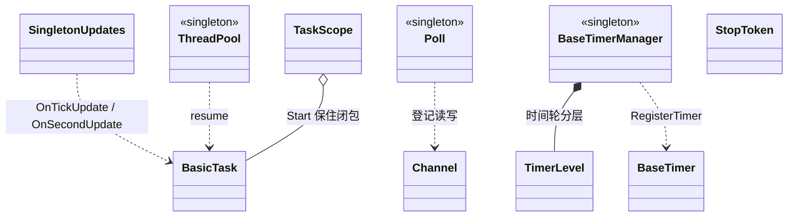
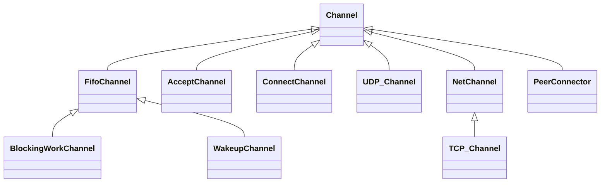
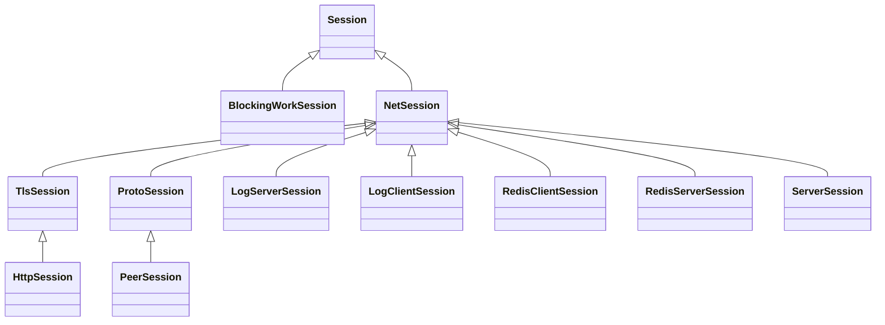
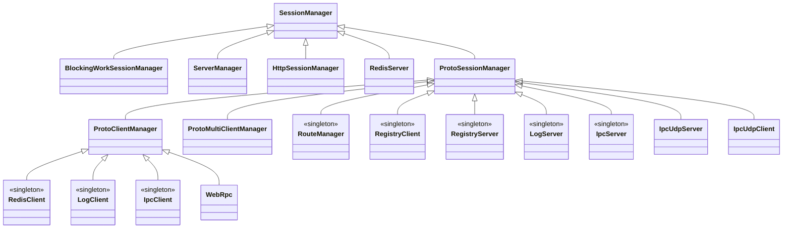
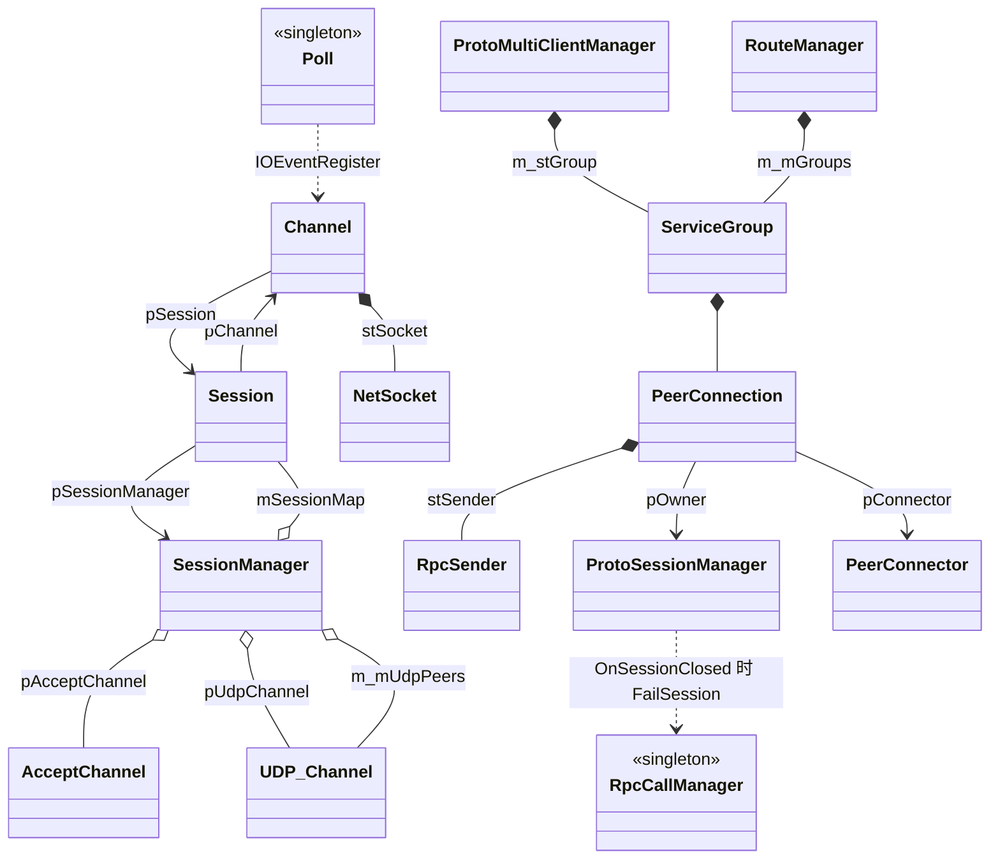
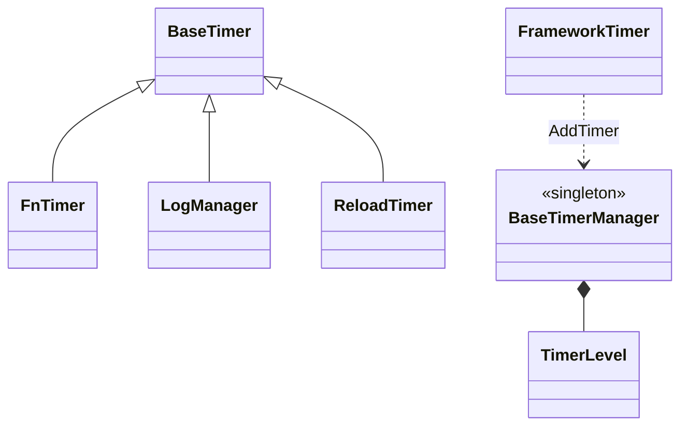
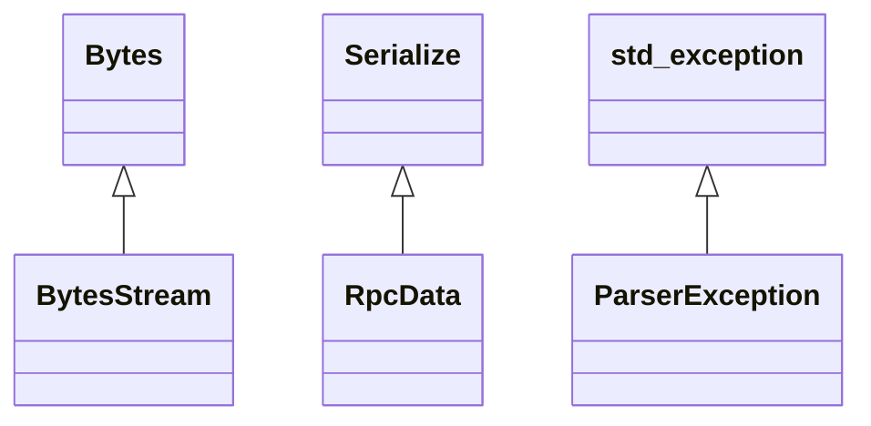
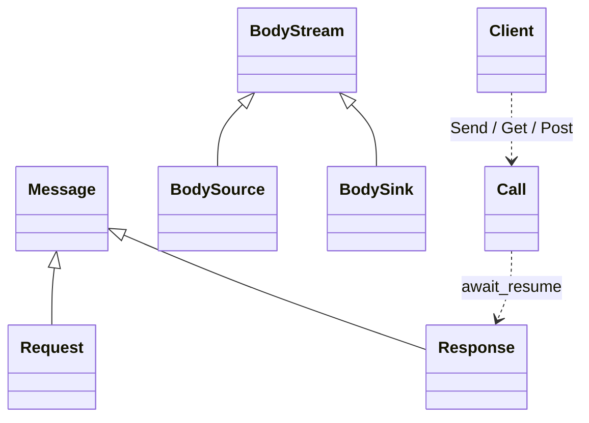
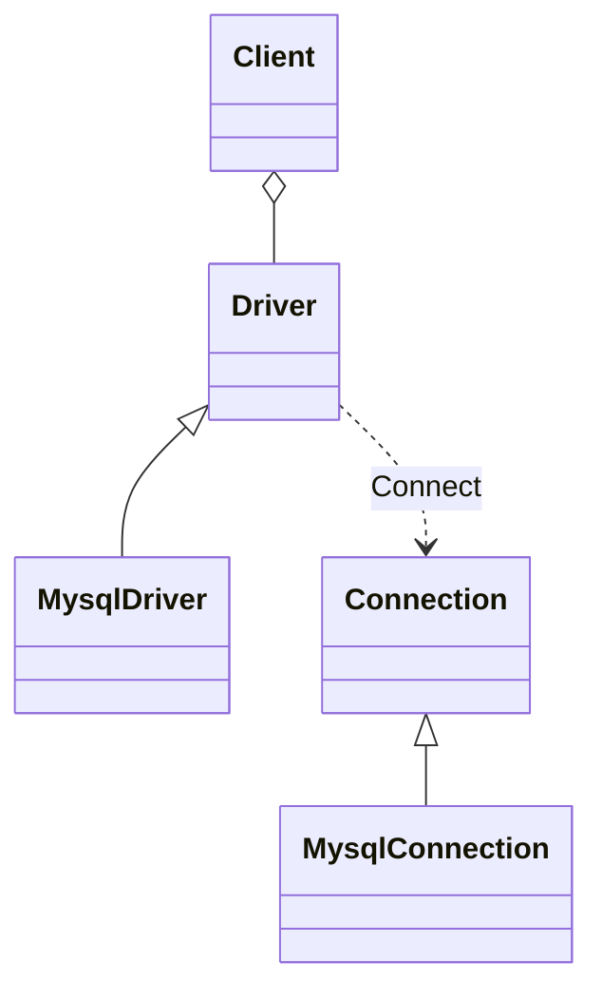
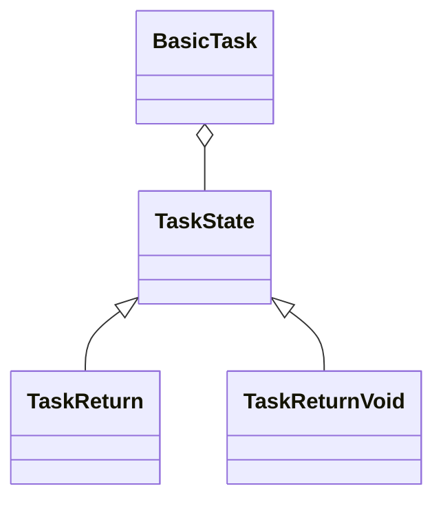

# 框架类图

类按继承树拆开。一张图只放一棵树，组合关系单独放，不画进继承图。`DECLARE_SINGLETON` 不进继承链，图里用 `<<singleton>>` 标出，实例用 `GetInstance()` 拿。

改类时只动两处：对应图里的那一条边，以及文末索引里的那一行。新增子类同样加一条边、加一行。不要把几棵树并成一张。

不收录：

- 第三方库。
- 模板萃取和协议号推导，例如 `RpcHandlerArgs`、`HasTickUpdate`。生成出来的具体 rpcdata 都继承 `RpcData`，不逐个列出。
- 测试夹具。`modules` 里只挂各进程的常驻入口，探测类留在文末。

实线空心三角是继承。组合图里实线是持有，虚线是使用或创建；标出的成员名以头文件为准。

## 调度

这几类没有共同基类。`StartFramework` 拉起线程池、时间轮和 `Poll`。协程任务入 `ThreadPool` 的队列，多线程由工人 `resume`，单线程由 `Poll` 所在线程推进。

`Task` 是 `BasicTask<void>`，`TaskResult<T>` 是 `BasicTask<T>`。阻塞池的类 `BlockingPool` 只在 `cbaselib/base/src/oi_blocking_pool.cpp` 内部，外面用 `SubmitBlockingWork`。完成通知走 `BlockingWorkChannel`。

## 通道

`WakeupChannel` 是 `Poll::State` 里的私有类。`PeerConnector` 在 `oi_rpc_peer.cpp`，只服务一条 `PeerConnection` 的建连。`ConnectChannel` 由 `NetHelper` 在连接尚未完成时创建并交给 `Poll`，不是 `SessionManager` 的成员。连接完成后会话底下换成 `TCP_Channel`。

## 会话

`ProtoSessionManager::CloneSession` 默认 `new ProtoSession`。固定地址那条连接不走这个默认实现：`AdoptPeer` 直接构造 `PeerSession`，再配一条 `TCP_Channel`。`RedisClient`、`LogClient`、`LogServer` 虽然继承协议管理器，克隆出来的会话是 `NetSession` 的子类，不经过 `ProtoSession`。

`BlockingWorkSession` 是 `BlockingWorkSessionManager` 的私有类。`HttpSession`、`PeerSession`、`ServerSession` 定义在对应的 cpp 里。

## 会话管理器

`IpcUdpServer`、`IpcUdpClient` 在代码里都叫 `IpcUdp`，分别在 `modules/ipcserver/inc/ipcudp.h` 和 `modules/ipcclient/inc/udp_mgr.h`。`HttpSessionManager` 在 `cbaselib/http/src/oi_http.cpp`，供 `Http::Client` 使用，`Client` 本身不继承管理器。`WebRpc` 在 `modules/webserver/src/web_server.cpp`。

## 一条连接上谁持有谁

监听口是 `AcceptChannel`，不是会话。UDP 绑定口是 `pUdpChannel`，每个对端再有一条 `UDP_Channel` 和一条会话。`ServiceGroup` 不是管理器，会话进 `pOwner` 的表。

## 定时器

`ReloadTimer` 在 `cbaselib/registry/src/registry_server.cpp`。单例的周期任务不挂 `BaseTimer`，由 `SingletonUpdates` 调 `OnTickUpdate` 或 `OnSecondUpdate`。

## 字节和协议数据

`ParserException` 的基类是 `std::exception`。具体 rpcdata 由生成器从 `RpcData` 派生。

## HTTP 报文

`ServerManager`、`HttpSession`、`HttpSessionManager` 的继承已在上面两棵树里。

## 数据库

`MysqlDriver`、`MysqlConnection` 在 `cbaselib/db/src/oi_mysql.cpp`。`Client` 通过 `Call`、`Transaction` 把语句交给池里的 `Connection`。

## 锁

`Mutex`、`SpinLock`、`MutexCond`、`LockGuard` 各有一套声明。单线程编译下加锁和等待是空实现，多线程下 `Mutex` 是递归锁。这是条件编译的两套实现，不是子类。`NativeMutex`、`NativeMutexGuard`、`NativeMutexCond` 在单线程构建里也是真锁。守卫不继承锁。

## 协程帧

`TaskReturnVoid` 在代码里是 `TaskReturn<void>`。`WhenAllState`、`RpcCallAwaiter`、`RouteAwaiter` 是等待器，不继承 `BasicTask`。

## 索引

| 类 | 直接基类 | 声明 |
| --- | --- | --- |
| `ThreadPool` | 无 | `cbaselib/base/inc/oi_thread.h` |
| `BasicTask` | 无 | `cbaselib/base/inc/oi_coro.h` |
| `TaskScope` | 无 | `cbaselib/base/inc/oi_coro.h` |
| `StopToken` | 无 | `cbaselib/base/inc/oi_coro.h` |
| `TaskState` | 无 | `cbaselib/base/inc/oi_coro.h` |
| `TaskReturn` | `TaskState` | `cbaselib/base/inc/oi_coro.h` |
| `TaskReturn<void>` | `TaskState` | `cbaselib/base/inc/oi_coro.h` |
| `SingletonUpdates` | 无 | `cbaselib/base/inc/oi_singleton.h` |
| `Bytes` | 无 | `cbaselib/base/inc/oi_bytes.h` |
| `BytesStream` | `Bytes` | `cbaselib/base/inc/oi_bytes_stream.h` |
| `Serialize` | 无 | `cbaselib/base/inc/oi_rpc.h` |
| `RpcData` | `Serialize` | `cbaselib/base/inc/oi_rpc.h` |
| `Poll` | 无 | `cbaselib/net/inc/oi_poll.h` |
| `WakeupChannel` | `FifoChannel` | `cbaselib/net/src/oi_poll.cpp` 内 `Poll::State` |
| `Channel` | 无 | `cbaselib/net/inc/oi_channel.h` |
| `FifoChannel` | `Channel` | `cbaselib/net/inc/oi_fifo_channel.h` |
| `BlockingWorkChannel` | `FifoChannel` | `cbaselib/net/inc/oi_blocking_work_channel.h` |
| `AcceptChannel` | `Channel` | `cbaselib/net/inc/oi_accept_channel.h` |
| `ConnectChannel` | `Channel` | `cbaselib/net/inc/oi_connect_channel.h` |
| `UDP_Channel` | `Channel` | `cbaselib/net/inc/oi_udp_channel.h` |
| `NetChannel` | `Channel` | `cbaselib/net/inc/oi_net_channel.h` |
| `TCP_Channel` | `NetChannel` | `cbaselib/net/inc/oi_tcp_channel.h` |
| `NetSocket` | 无 | `cbaselib/net/inc/oi_socket.h` |
| `Session` | 无 | `cbaselib/net/inc/oi_session.h` |
| `NetSession` | `Session` | `cbaselib/net/inc/oi_net_session.h` |
| `TlsSession` | `NetSession` | `cbaselib/net/inc/oi_tls_session.h` |
| `SessionManager` | 无 | `cbaselib/net/inc/oi_session_manager.h` |
| `BlockingWorkSessionManager` | `SessionManager` | `cbaselib/net/inc/oi_blocking_work_session.h` |
| `BlockingWorkSession` | `Session` | `cbaselib/net/src/oi_blocking_work_session.cpp` |
| `ProtoSession` | `NetSession` | `cbaselib/proto/inc/oi_rpc_session.h` |
| `PeerSession` | `ProtoSession` | `cbaselib/proto/src/oi_rpc_peer.cpp` |
| `PeerConnector` | `Channel` | `cbaselib/proto/src/oi_rpc_peer.cpp` |
| `PeerConnection` | 无 | `cbaselib/proto/inc/oi_rpc_peer.h` |
| `ServiceGroup` | 无 | `cbaselib/proto/inc/oi_rpc_peer.h` |
| `RpcSender` | 无 | `cbaselib/proto/inc/oi_rpc_call.h` |
| `RpcCallManager` | 无 | `cbaselib/proto/inc/oi_rpc_call.h` |
| `ProtoSessionManager` | `SessionManager` | `cbaselib/proto/inc/oi_rpc_session_manager.h` |
| `ProtoClientManager` | `ProtoSessionManager` | `cbaselib/proto/inc/oi_rpc_session_manager.h` |
| `ProtoMultiClientManager` | `ProtoSessionManager` | `cbaselib/proto/inc/oi_rpc_session_manager.h` |
| `RouteManager` | `ProtoSessionManager` | `cbaselib/proto/inc/oi_rpc_session_manager.h` |
| `RegistryClient` | `ProtoSessionManager` | `cbaselib/proto/inc/oi_registry_client.h` |
| `RegistryServer` | `ProtoSessionManager` | `cbaselib/registry/src/registry_server.h` |
| `BaseTimer` | 无 | `cbaselib/timer/inc/oi_timer.h` |
| `FnTimer` | `BaseTimer` | `cbaselib/timer/inc/oi_timer_manager.h` |
| `BaseTimerManager` | 无 | `cbaselib/timer/inc/oi_timer_manager.h` |
| `TimerLevel` | 无 | `cbaselib/timer/inc/oi_timer_level.h` |
| `FrameworkTimer` | 无 | `cbaselib/timer/inc/oi_framework_timer.h` |
| `ReloadTimer` | `BaseTimer` | `cbaselib/registry/src/registry_server.cpp` |
| `LogClient` | `ProtoClientManager` | `cbaselib/logger/inc/oi_log_client.h` |
| `LogClientSession` | `NetSession` | `cbaselib/logger/inc/oi_log_client_session.h` |
| `LogServer` | `ProtoSessionManager` | `cbaselib/logd/inc/log_server.h` |
| `LogServerSession` | `NetSession` | `cbaselib/logd/inc/log_server_session.h` |
| `LogManager` | `BaseTimer` | `cbaselib/logd/inc/log_manager.h` |
| `RedisClient` | `ProtoClientManager` | `cbaselib/redis/inc/oi_redis.h` |
| `RedisClientSession` | `NetSession` | `cbaselib/redis/inc/oi_redis_session.h` |
| `Client` | 无 | `cbaselib/http/inc/oi_http.h` |
| `Call` | 无 | `cbaselib/http/inc/oi_http.h` |
| `Message` | 无 | `cbaselib/http/inc/oi_http_message.h` |
| `Request` | `Message` | `cbaselib/http/inc/oi_http_message.h` |
| `Response` | `Message` | `cbaselib/http/inc/oi_http_message.h` |
| `BodyStream` | 无 | `cbaselib/http/inc/oi_http_message.h` |
| `BodySource` | `BodyStream` | `cbaselib/http/inc/oi_http_message.h` |
| `BodySink` | `BodyStream` | `cbaselib/http/inc/oi_http_message.h` |
| `ServerManager` | `SessionManager` | `cbaselib/http/inc/oi_http_server.h` |
| `ServerSession` | `NetSession` | `cbaselib/http/src/oi_http_server.cpp` |
| `HttpSessionManager` | `SessionManager` | `cbaselib/http/src/oi_http.cpp` |
| `HttpSession` | `TlsSession` | `cbaselib/http/src/oi_http.cpp` |
| `Driver` | 无 | `cbaselib/db/inc/oi_db.h` |
| `Connection` | 无 | `cbaselib/db/inc/oi_db.h` |
| `Client`（数据库） | 无 | `cbaselib/db/inc/oi_db.h` |
| `MysqlDriver` | `Driver` | `cbaselib/db/src/oi_mysql.cpp` |
| `MysqlConnection` | `Connection` | `cbaselib/db/src/oi_mysql.cpp` |
| `IpcServer` | `ProtoSessionManager` | `modules/ipcserver/inc/ipcserver.h` |
| `IpcUdp`（ipcserver） | `ProtoSessionManager` | `modules/ipcserver/inc/ipcudp.h` |
| `IpcClient` | `ProtoClientManager` | `modules/ipcclient/inc/ipcclient.h` |
| `IpcUdp`（ipcclient） | `ProtoSessionManager` | `modules/ipcclient/inc/udp_mgr.h` |
| `RedisServer` | `SessionManager` | `modules/redisserver/inc/redis_server.h` |
| `RedisServerSession` | `NetSession` | `modules/redisserver/inc/redis_server_session.h` |
| `WebRpc` | `ProtoClientManager` | `modules/webserver/src/web_server.cpp` |

## 不进图的探测类

这些类继承管理器或会话，只为回归构造场景，不放进上面的树：`PollUdpCloseProbe`、`BlockingAccessClient`、`UdpSecondPeer`、`UdpBudgetProbe`、`ConnectMgr::ClientConnectProbe`、`AddressMgr::AddressConnectProbe`、`ListWatchProbe`、`ConnectGenerationProbe`、`DeferredRpcProbe`、`RedisFairPeer` 及其内部会话。
