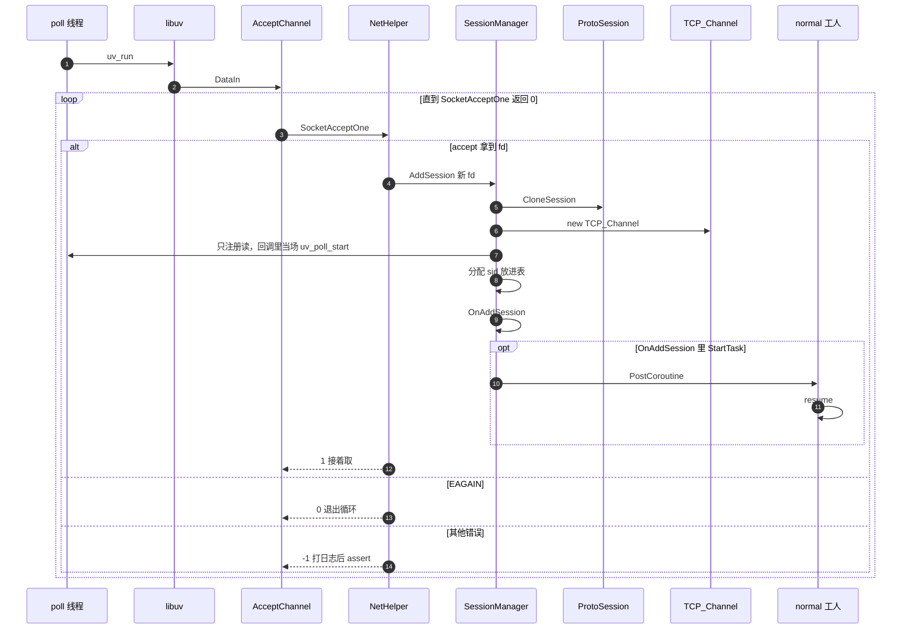

# 接入一条连接

可读发生在 poll 线程。新连接的读事件在这次回调里当场挂上。`OnAddSession` 里的 `StartTask` 把句柄放进 `normal` 工人队列，工人可以在这次回调返回前就开始 `resume`。

`EINTR` 在 `SocketAcceptOne` 里面重试，不回到这层循环。

对端关掉或读出错时，先把已经读到的字节交给 `OnDataIn`，再 `PassiveClose`。
