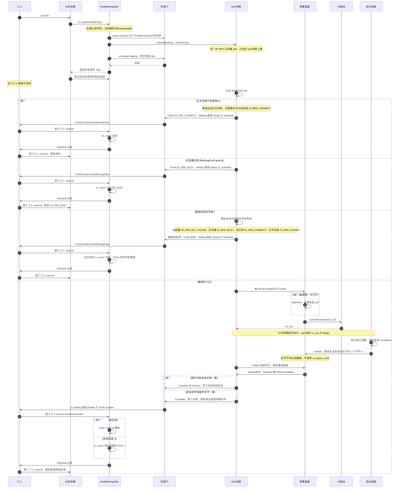

# 阻塞任务

业务在工人上 `co_await RunBlocking`。前端不是协程：右值进闭包，再进入 `RunBlockingTask`。协程里调用时，`RunBlockingTask` 当场跑到 `BlockingAwaiter`。`await_suspend` 先记下这条任务的句柄，再 `SubmitBlocking`。

工人、poll、分类池的后台线程是三条线。`CallOnLoop` 发现不在 poll 线程，只 `PostOnLoop`。操作队列从空变成非空时，用 poll 自己的那对 FIFO 写一个唤醒字节，读端只负责通知。`SubmitOnLoop` 要等 poll 线程执行。

工人接着 `exchange(Waiting)`。这次回调通常还没跑，门仍是 `Idle`，`RunBlockingTask` 挂起，业务再登记到任务等待列表并挂起。poll 上的拒绝和提交失败稍后 `Finish`。门从 `Waiting` 换成 `Ready` 才 `Schedule`。先唤醒 `RunBlockingTask`，它 `co_return` 后再把业务放进工人队列。回到哪个工人没有保证。若 poll 在 `exchange(Waiting)` 之前已经把门写成 `Ready`，工人看见 `Ready` 就不挂起；完成回调看见的不是 `Waiting`，不再 `Schedule`。

已关闭，或线程池已请求停止，返回 `OI_ERR_CONNECT`。本地会话已经关闭，也是 `OI_ERR_CONNECT`。该类型在途数达到 `BlockingPoolCapacity`，返回 `OI_ERR_BUSY`。在途含排队、执行中和完成通知还没消费的工作；Default 的上限是线程数加队列上限，再与 1024 取较小值。

未配置的非 `Default` 不在池表里，容量按 0 算，不在入场判忙。`SubmitBlockingWork` 返回 `OI_ERR_NOT_FOUND`。池队列已满返回 `OI_ERR_BUSY`，池已停止返回 `OI_ERR_CONNECT`。打开 socketpair 或登记读端失败返回 `OI_ERR_SOCKET`。提交过程抛出的异常用 `Finish(OI_OK, 异常)` 交回。这些都在 poll 上写完再唤醒，`await_resume` 对异常重抛，对非 0 状态码原样返回。

接纳后在 poll 上分配操作号，跳过 0，也不占用仍在途的号。编一帧 `WorkCompleted`，协议号 `WORK_PROTOCOL_COMPLETED`，包体只有操作号。通道第一次打开本地 socketpair，读端挂到 poll。`SubmitBlockingWork` 只把工作放进该类型的队列。不使用 `uv_queue_work`。

工作线程执行用户函数，异常收进 completion，然后 `Publish`。链表从空变成非空时，阻塞通道 `Wakeup` 写一个字节 `w`。这个字节不带业务数据，和 poll 操作队列不是同一对套接字。poll 在 `uv_run` 里 `DataIn`，读掉字节，取走整条链表，`SwapInBuff` 交给会话。操作号必须和完成记录一致，然后 `Complete`。协议损坏也 `Complete`，带上异常，不能把等待者丢下。

`fnDone` 写下状态码和异常。`Complete` 这条路径写入的状态码是 0，用户函数的 `int32_t` 留在结果里。`await_resume` 有异常就重抛；没有异常时，非 0 的池状态原样作为任务结果，0 则 `co_return` 用户函数的 `int32_t`。丢弃 Task 不取消工作。

`exchange(Waiting)` 若已经看见 `Ready`，上面的挂起不会发生，完成回调也不再 `Schedule`。丢弃 Task 不取消已经进池的工作。
