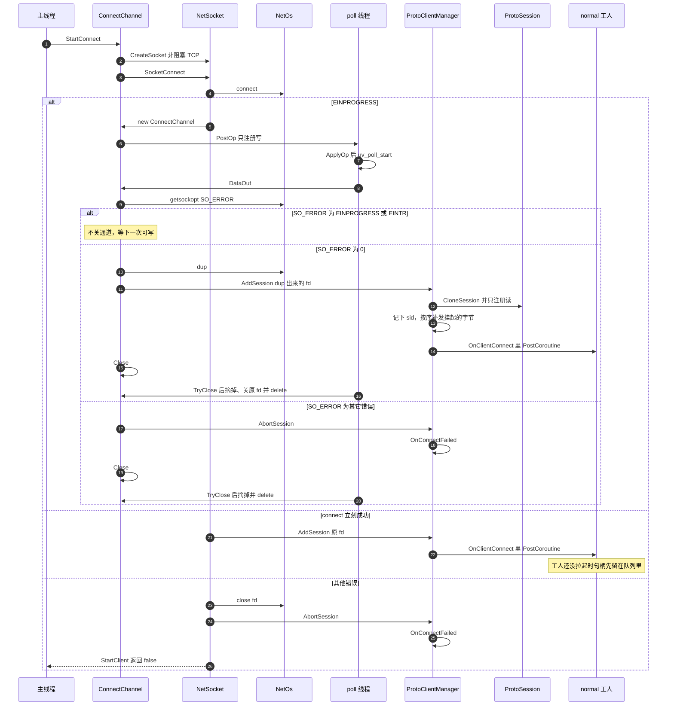

# 客户端连上

`StartClient` 在主线程发起。poll 线程从 `Poll::Init` 起就在转，写事件通过操作队列交给它。可写可能赶在 `StartWork` 之前。

`SO_ERROR` 为 `EINPROGRESS` 或 `EINTR` 时通道留着，等下一次可写。Windows 上 `WSAEWOULDBLOCK`、`WSAEINPROGRESS` 会收成 `EINPROGRESS`。其它错误才 `AbortSession`，然后关掉这条连接通道。成功时 dup 一只 fd 交给会话，原 fd 随连接通道关掉。不能直接交原 fd：旧 uv_poll 关闭时会对这只 fd 做 epoll DEL，新会话的监听会被一起删掉。dup 失败按连接失败走 AbortSession。对端拒绝时 libuv 只回调错误、不报可写，还会停掉监听，所以 DataIn 里同样读 SO_ERROR 收尾。立刻失败时关掉 fd 并 AbortSession，走同一条重连。`connect` 立刻成功的路径同样交原 fd。

`ipcclient` 的 `OnClientConnect` 里再 `Start` 回声、日志和 Hold。
