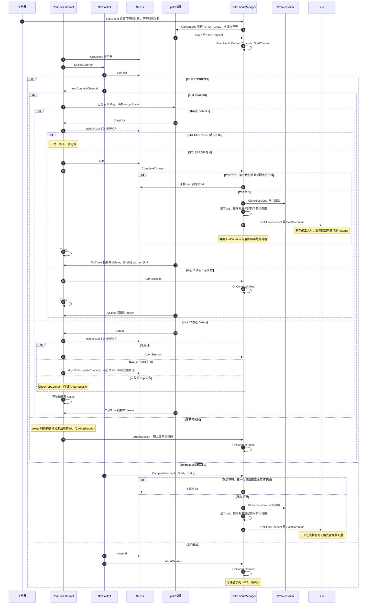

# 客户端连上

`StartClient` 在主线程发起。poll 从 `Poll::Init` 起就在转。`BeginConnect` 不在 poll 线程，`CallOnLoop` 投递 `IO_OP_CALL`，主线程不等。poll 线程 `Drain` 后 `StartConnect`。写事件在 poll 线程当场挂上，可写可能赶在 `StartWork` 之前。返回的是可等待对象，不等待也会发起连接。字面地址在 `Resolve` 里当场回调；域名走 `uv_getaddrinfo`，回调仍在 poll 线程。

`EINPROGRESS` 新建 `ConnectChannel`，只注册写。`connect` 立刻返回 0 时，原 fd 交给 `CompleteConnect`，不 dup。`OnAddSession` 里的 `StartTask` 放进工人队列。工人已经在跑时，可以在回调返回前 resume；还没 `StartWork` 时句柄先留在队列里。

`SO_ERROR` 为 `EINPROGRESS` 或 `EINTR` 时，`DataOut` 留着等下一次可写。Windows 上 `WSAEWOULDBLOCK`、`WSAEINPROGRESS` 收成 `EINPROGRESS`。其它错误才 `AbortSession`，然后关掉这条连接通道。成功时 `CheckTcpConnect` 里 dup，原 fd 留给连接通道关掉。不能把已经挂上 poll 的原 fd 直接交给新会话：Linux 上旧 uv_poll 关闭时会 epoll DEL，把新会话的监听一起删掉；Windows 走同一条 dup，不把这个原 fd 交出去。dup 失败走 `AbortSession`。`DataIn` 同样读 `SO_ERROR`，不论结果都 `Close`：libuv 遇到错误会停掉 poll，可写不会再来；这时若还在连，要先 `AbortSession`。`CompleteConnect` 校验代次，代次不符、这一代已经结束或服务已下线，就关掉交过来的 fd。`AddSession` 没建成会话时不进 `OnAddSession`，等待者拿到它的错误码，再 `OnConnectFailed`。

立刻失败时关掉 fd 并 `AbortSession`。`OnConnectFailed` 在允许自动重连时再定时 `StartClient`。解析失败且这一代还挂着，也走 `AbortSession`。已经连上同一端点就直接成功，不再 `connect`。

`ipcclient` 的 `OnClientConnect` 里再拉起回声、协程、空消息、日志、Hold 和数据库测试，进程内只做一次。

`StartClient()` 不等待也会启动连接；`co_await StartClient()` 等待同一代连接的结果，成功返回 `OI_OK`，失败返回对应错误码。回调先于 await 到达时保留结果，后续 await 不丢唤醒；无布尔模式参数。
