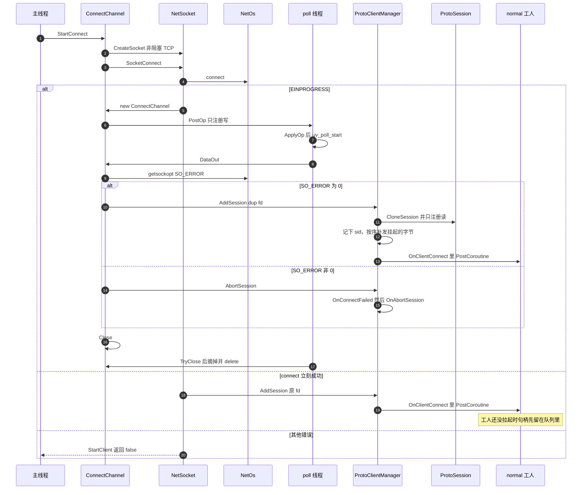

# 客户端连上

`StartClient` 在主线程发起。poll 线程从 `Poll::Init` 起就在转，写事件通过操作队列交给它。可写可能赶在 `StartWork` 之前。

下面是当前代码。完成阶段有两处待改，行为先不动。

待改：

- `SO_ERROR` 为 `EINPROGRESS` 或 `EINTR` 时，分支是空的，后面仍调用 `AbortSession`。`DataOut` 接着无条件 `Close`，`ConnectChannel` 被摘掉，等不到下一次可写。`ipcclient` 的 `OnAbortSession` 是空的，这次失败不会重连。Windows 上 `NetOs_GetSocketError` 还会把 `WSAEWOULDBLOCK`、`WSAEINPROGRESS` 收成 `EINPROGRESS`。HTTP 客户端的 `OnWritable` 对这些值是留下再等。
- 成功时 `NetOs_Dup` 复制套接字再 `AddSession`，原 fd 留在 `ConnectChannel` 里，随后析构关掉。`dup` 失败得到无效句柄，`AddSession` 不检查。`connect` 立刻成功的那条路径是把原 fd 直接交出去的。异步成功也应交出这只套接字，不要复制。

`ipcclient` 的 `OnClientConnect` 里再 `Start` 回声、日志和 Hold。
