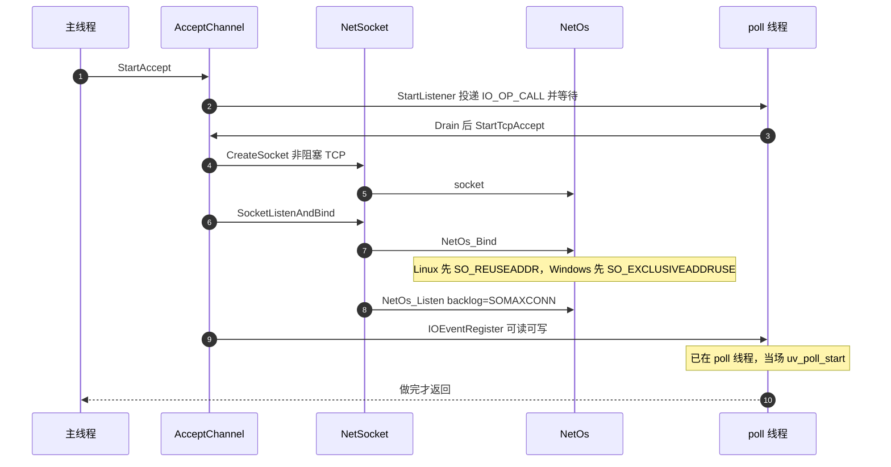

# 服务端开始听

`StartServer` 在主线程，poll 在另一条线程上。`StartListener` 不在 poll 线程时投递 `IO_OP_CALL`，空队列就唤醒 poll，主线程等到做完才返回。这里只 bind 和 listen，还没有连接。

`NetOs_Bind` 在 Linux 上先 `SO_REUSEADDR` 再 bind，Windows 上先 `SO_EXCLUSIVEADDRUSE` 再 bind。`listen` 的 backlog 是 `SOMAXCONN`。`type=udp` 不走这条，回调里转到 `UDP_Channel::StartBind`。

多线程的 `CheckThreadAccess` 不拦主线程。TCP 听上之后还要 `Publish`，失败就 `StopAccept`。UDP 不登记。

