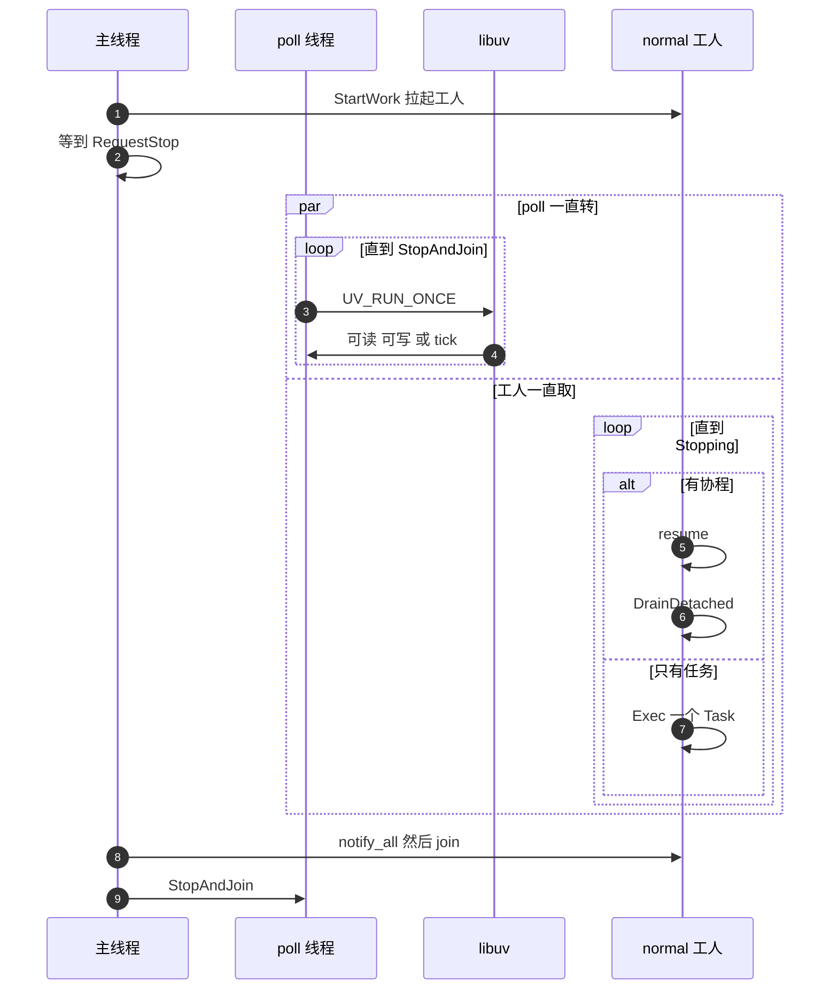

# 主循环

三条线同时走。主线程只等停止。poll 线程只做 `uv_run`。工人等 `normal` 队列里的任务或协程。协程 `resume` 之后才 `DrainDetached`，不在 `final_suspend` 里销毁帧；执行普通任务之后不调。

`queue` 工人单独一条，时间轮 `Update` 走它，不跟 `normal` 抢。

`Schedule` 是 `PostCoroutine`：句柄放进 `normal` 队列，有空闲工人才 `notify_one`。
