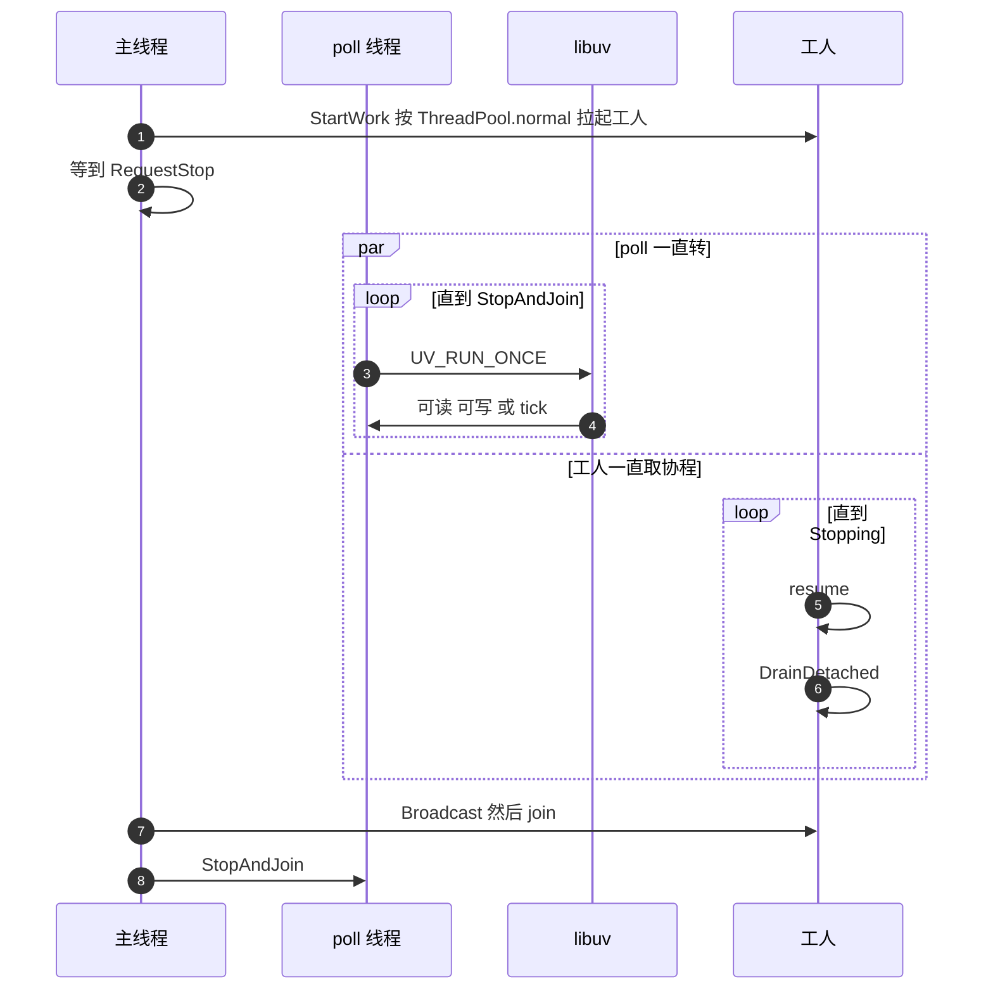

# 主循环

三条线同时走。主线程只等停止。poll 线程只做 `uv_run`。工人只从协程队列取句柄并 `resume`。协程 `resume` 之后才 `DrainDetached`，不在 `final_suspend` 里销毁帧。

时间轮 `Update` 由 poll 线程在 tick 里直接执行，不经工人。

`Schedule` 是 `PostCoroutine`：句柄放进协程队列，有空闲工人才 `Signal`。
