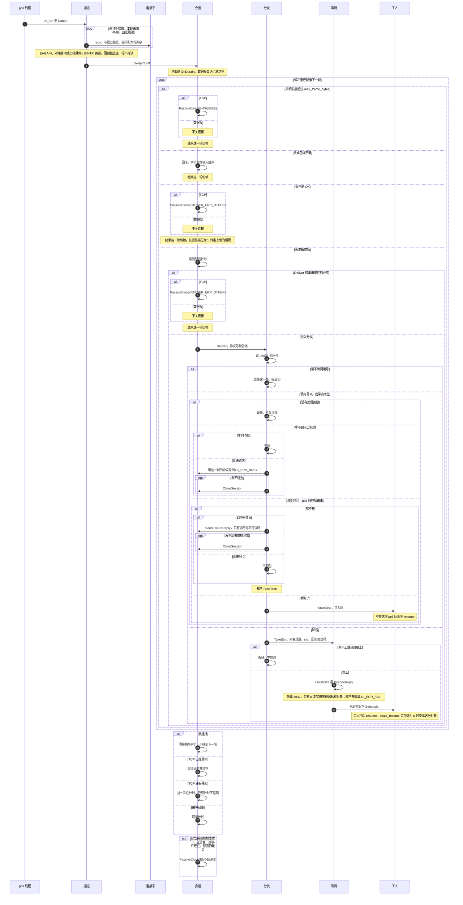

# 收到一帧

读发生在 poll 线程的 `uv_run` 里。一轮最多读 4MB，还要看会话的 `ReceiveAllowance`。通道缓冲顶到额度就先 `SwapInBuff` 交给解析；解析后仍无空间，会话没关，读事件还在，就 `PassiveClose(ENOBUFS)`。

切帧在 `OnDataIn`。先读 `uint64` 调用号：0 是单向消息，请求位是 `RPC_REQ_MASK`。回包要 `TakeSlot` 同时对上管理器、sid 和回包协议号，对上才在 poll 线程 `DecodeReply`，调用方已经挂起才 `Schedule`。请求在 poll 线程解开后才 `StartTask`。这两处都只入队，不在 poll 回调里 `resume`。

TCP 头或包体不够就回滚，字节留在输入缓冲，同一残包只挂一次计时。数据报不走这条 `recv`，和 TCP 共用切帧，剩余字节不拼到下一包。

计时用 `incomplete_frame_timeout_ms`，默认 10000，到点 `PassiveClose(ETIMEDOUT)`；计时器没配上则是 `ENOBUFS`。对端关闭或读出错时，只要有错误码或读事件还在，也会 `PassiveClose`。回包比挂起先到时完成门已是 Ready，不再 `Schedule`。
