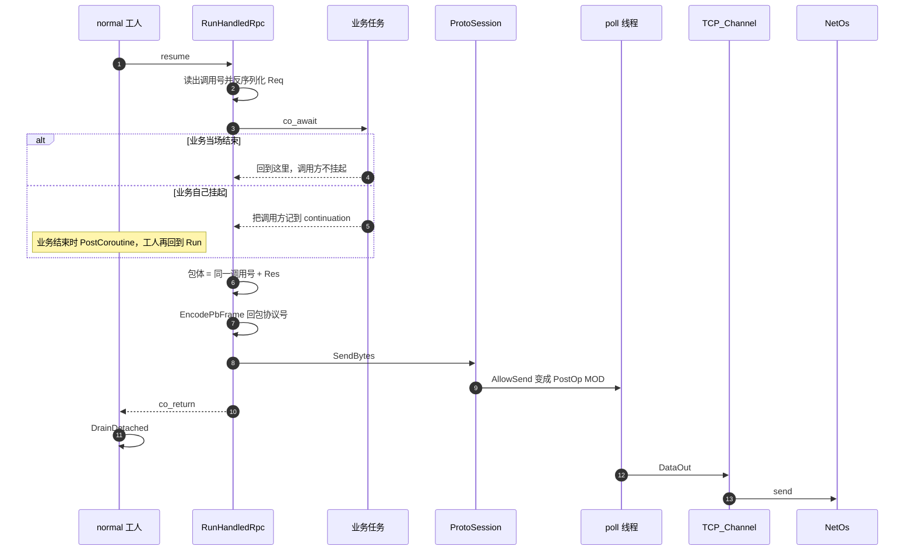

# 处理并回包

处理协程在 `normal` 工人上跑。业务当场结束时，调用方不挂起。回包在工人里写进发送缓冲，写事件交给 poll 线程。`send` 不在工人上。

`co_return` 不在 `final_suspend` 里销毁帧。工人 `resume` 返回后 `DrainDetached` 再销毁。

`ipcserver` 的 `AllEcho` 是同步处理，当场把 `stData` 抄进回包并写 `iCode = 1`。`Hold` 在 `iDelayMilliseconds > 0` 时先 `co_await OI::Coro::yield`，到点再回。负数延迟用业务码 `1001` 返回，回执不带响应体。
