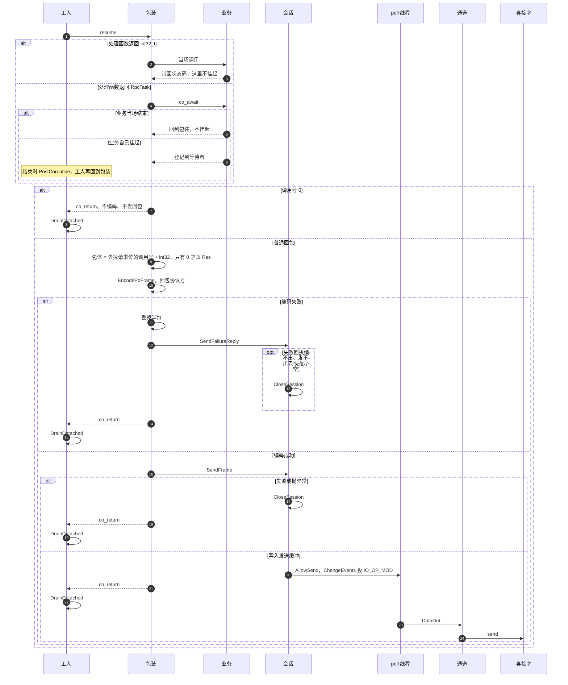

# 处理并回包

处理协程在工人上跑。处理函数可以返回 `int32_t`，当场调用；也可以返回 `RpcTask`，再 `co_await`。调用号 0 在业务结束后直接 `co_return`，不编码、不发回包。

普通回包的包体是去掉请求位的调用号，加上 int32 状态码，只有 0 才跟 Res。`EncodePbFrame` 用回包协议号。编码失败丢掉半包，改走 `SendFailureReply`。`SendFrame` 失败或发送抛异常就 `CloseSession`。写事件经 `ChangeEvents` 投到 poll 线程，工人这次投的是 `IO_OP_MOD`。`send` 只在 poll 线程的 `DataOut`。

`co_return` 不在 `final_suspend` 里销毁帧。工人 `resume` 返回后 `DrainDetached` 再销毁。

`ipcserver` 的 `AllEcho` 是同步处理，当场把 `stData` 抄进回包并写 `iCode = 1`。`Hold` 在 `iDelayMilliseconds > 0` 时先 `co_await OI::Coro::yield`，到点再回。负数延迟用业务码 `1001` 返回，回执不带响应体。
