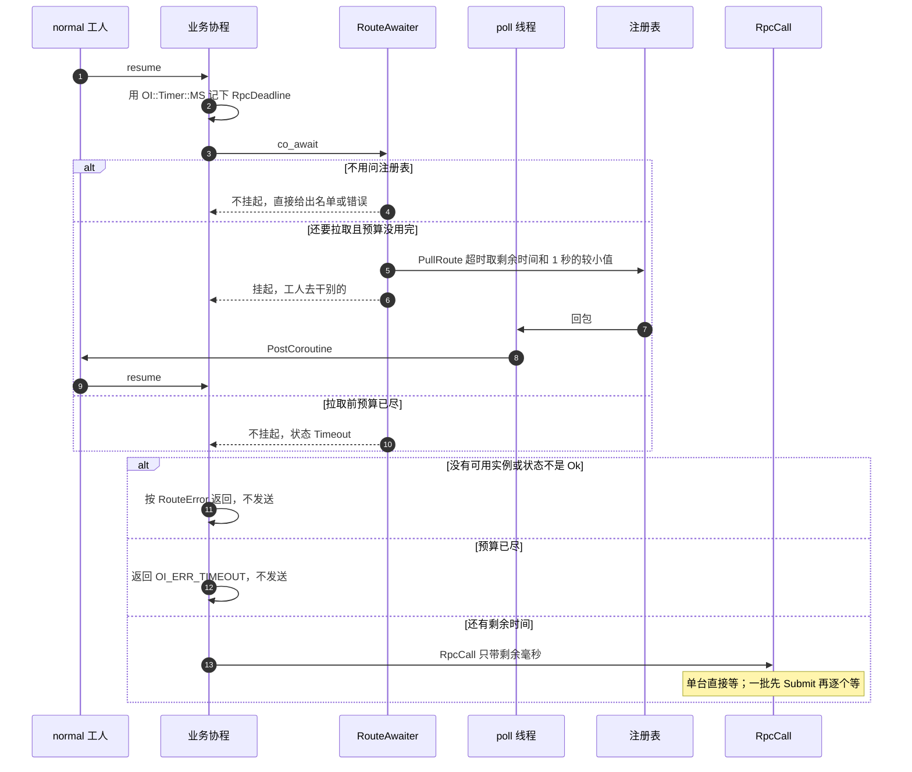

# 按服务名调用

`CallAny`、`Call`、`CallAll`、`CallMany` 在调用时就建好 `RpcDeadline`：单调时钟上的一个截止点，查询注册表、建连排队和回包共用它。非正时长不设截止。

选路协程在 `normal` 工人上跑。快路径不挂起：名字非法、自己已经连着这个名字、或者截止点已经过了。要问注册表时挂起，`PullRoute` 只用剩余时间和 1 秒里较短的那个。回包从 poll 线程 `PostCoroutine` 回工人，不在回调里 `resume`。

名单到了以后，剩下的时间再交给下面的 `RpcCall`。预算已经用完就不再发送，返回 `OI_ERR_TIMEOUT`。`CallAll` 和 `CallMany` 对每一台先 `Submit`，再逐个等；某一格没登记是 `OI_ERR_CONNECT`，轮到它时预算已尽是 `OI_ERR_TIMEOUT`，不挡住已经发出的其它格。

空的分区列表和负数分区号在拉取前就失败。断连只摘同一个管理器、同一个 `sessionid` 上的等待，另一个管理器上的相同数字不受影响。
