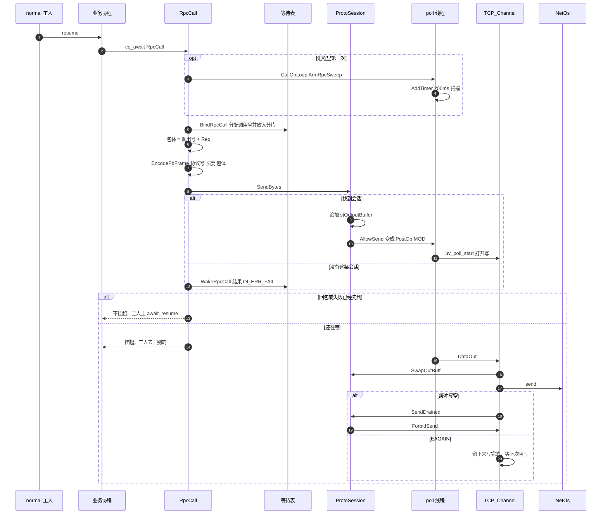

# 发出一次调用

这是一条 `RpcCall`。`CallAny` 和 `Call` 选好实例后走这里。`CallAll` 和 `CallMany` 对每一台先 `Submit`，把帧写进发送缓冲，再逐个 `co_await` 已经在途的等待器。

业务协程在 `normal` 工人上跑。挂起前就把帧写进发送缓冲。工人不是 poll 线程，打开写事件只是 `PostOp`。`send` 在 poll 线程的可写回调里。

回包、发送失败、超时，这三件事里只有先到的那一件会把协程放回队列。

解包在工人的 `await_resume`。解出来返回 `OI_OK`，解包失败返回 `OI_ERR_FAIL`。没收到回包就返回等待表里已经写下的结果。
