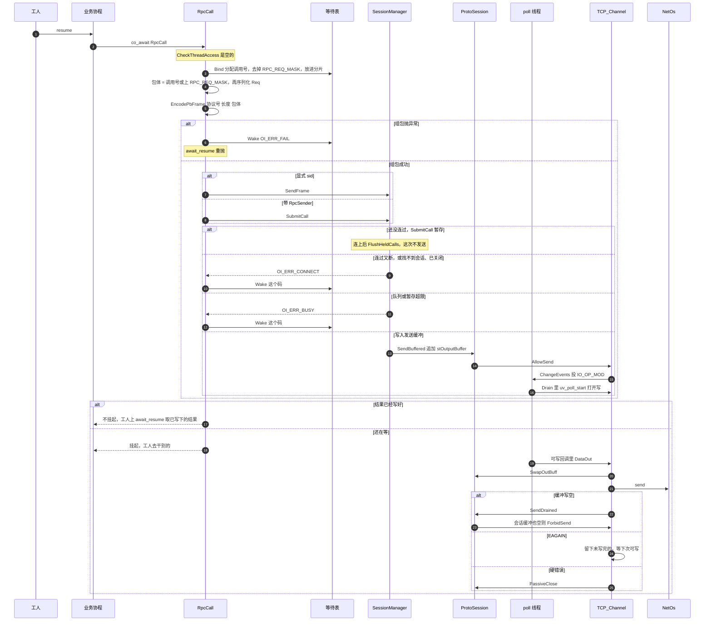

# 发出一次调用

这是一条 `RpcCall`。按服务名选实例见 [按服务名调用](route.md)。选路之后这里只用 `RpcDeadline` 剩下的毫秒。`CallAll` 和 `CallMany` 对每一台先 `Submit`，把帧写进发送缓冲，再逐个 `co_await` 已经在途的等待器。

业务协程在工人上跑。`CheckThreadAccess` 是空的，工人可以把帧追进发送缓冲。显式 sid 直接 `SendFrame`。按服务名或客户端对象发出时带 `RpcSender`，走 `SubmitCall`：已经连上再 `SendFrame`；还没连过就暂存，连上后 `FlushHeldCalls`；已经连过再断线是 `OI_ERR_CONNECT`；暂存超限是 `OI_ERR_BUSY`。打开写事件时 `ChangeEvents` 不在 poll 线程，投 `IO_OP_MOD`。`send` 在 poll 线程的可写回调里。

回包、发送失败、超时，这三件事里只有先到的那一件会 `Schedule`。还没连上就到期是 `OI_ERR_CONNECT`，已经发出后到期是 `OI_ERR_TIMEOUT`。

回包在 poll 线程的 `DecodeReply` 里解开，由 `FinishSlot` 调用，不在 `await_resume`。状态码为 0 时，`await_resume` 把已解出的对象移进调用方输出。解不开时码是 `OI_ERR_FAIL`，对象不移，异常只报告，不重抛。没收到回包就返回等待表里已经写下的码。

组包抛异常才 `Wake(OI_ERR_FAIL)` 并在 `await_resume` 重抛。槽已经被取走时，这次 `Wake` 不再改结果，异常仍重抛。poll 线程可以在工人 `Arm` 之前把回包解开并写好结果，这时不挂起，也不 `Schedule`。调用若已经在 poll 线程，`ChangeEvents` 当场打开写，不投 `IO_OP_MOD`。同一次还没取走时，后面的开关并进这一次 `IO_OP_MOD`。

`DataOut` 在 poll 线程，关写当场做。`EINTR` 再写一次。写空之后会话缓冲又有数据，就不 `ForbidSend`。硬错误 `PassiveClose` 之后关掉会话，还在表里的调用按 `OI_ERR_CONNECT` 结束。带对端地址的 UDP 不走这条 `DataOut`。`IO_OP_MOD` 之后哪一轮 `uv_run` 才进 `DataOut`，图里不区分。
