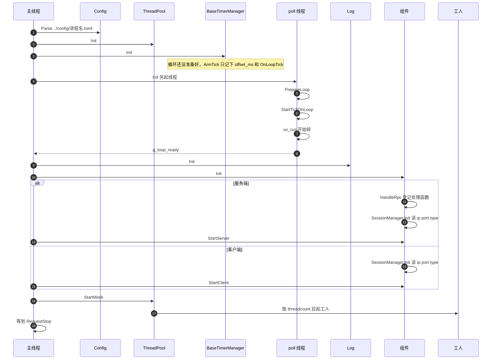

# 进程起来

多线程里 poll 先单独转起来。`StartWork` 再拉工人，主线程自己不 poll，堵到 `RequestStop`。

条数读 `ThreadPool.threadcount`，必须配，并且大于 0。旧键 `normal` 仍会作为兼容读一次：读不到 `threadcount` 时会再读 `normal`，读到了就在 stderr 打一行提示改名。缺了或不是正数，`ThreadPool::Init` 返回 false，进程起不来。旧配置里的 `urgent`、`queue`、`max_task_count` 不再读取，留着不报错。时间轮的 `Update` 在 poll 线程上跑。

`ipcclient` 在 `StartClient` 之前，若开了 Redis 或 Hold，会先发起 `RedisClient` 建连。HTTP 探测在 `ipcserver` 听上之后用 `StartTask` 拉起。此时工人可能还没起来，句柄先留在协程队列里，工人起来后能取到。
