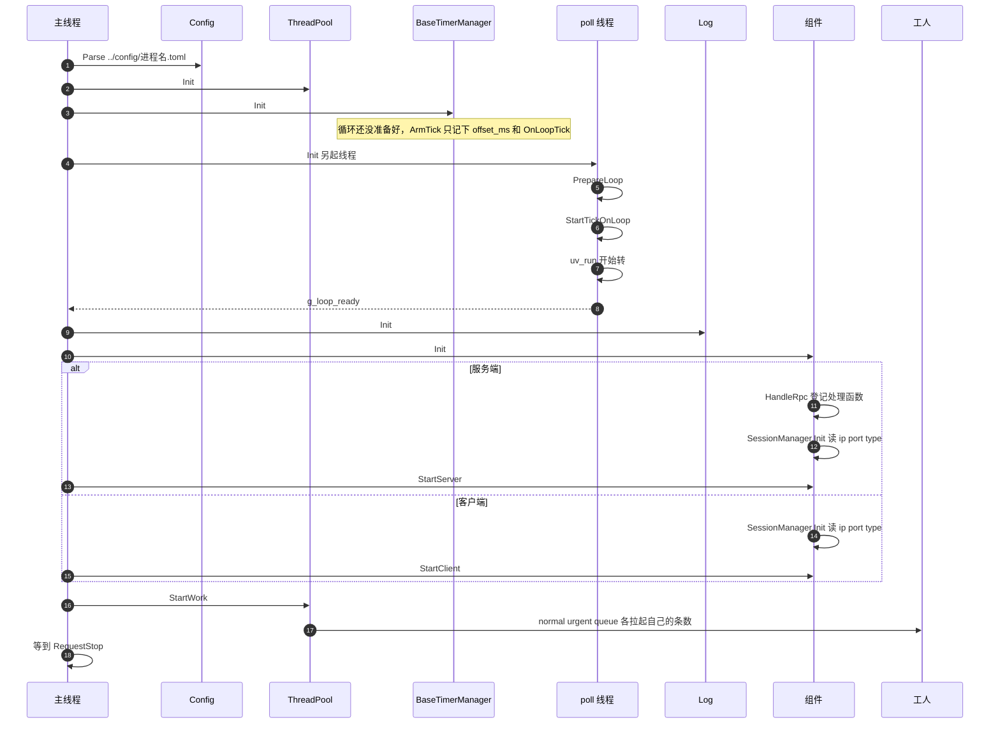

# 进程起来

多线程里 poll 先单独转起来。`StartWork` 再拉工人，主线程自己不 poll，堵到 `RequestStop`。

条数读 `ThreadPool.normal`、`ThreadPool.urgent`、`ThreadPool.queue`，三项都必须配。缺一项 `ThreadPool::Init` 就返回 false，进程起不来。`queue` 读到后强制改成 1 条，时间轮的 `Update` 走这条。

`ipcclient` 在 `StartClient` 之前，若开了 Redis 或 Hold，会先把 `RedisClient` 连上。HTTP 探测在 `ipcserver` 听上之后用 `StartTask` 拉起。此时工人可能还没起来，句柄先留在 `normal` 队列里，工人起来后谓词里能看到。
