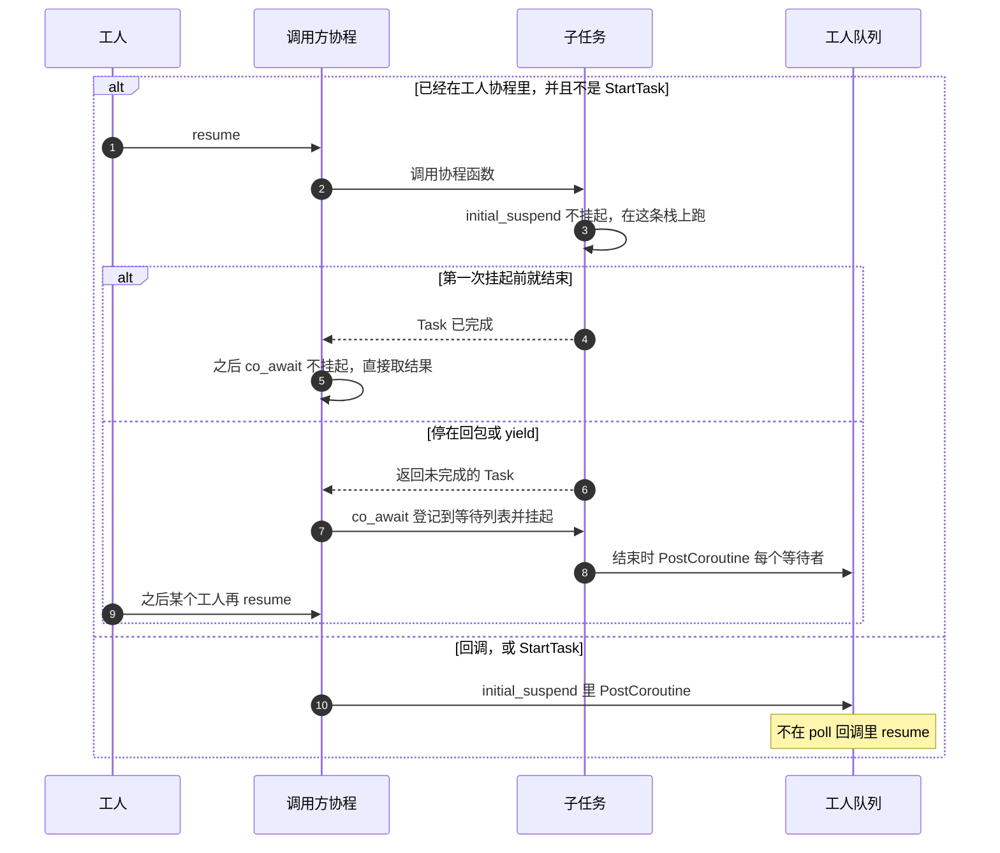

# 任务创建即运行

在工人上的协程里直接调用协程函数，子任务的 `initial_suspend` 不挂起，当场在这个工人的栈上跑到第一次 `co_await`。当场跑完的，外层之后的 `co_await` 不再挂起，直接取已保存的结果。

协程外（网络回调、定时器回调）新建的任务，以及 `StartTask`、`TaskScope::Start`，`initial_suspend` 把句柄放进工人队列，不在 poll 回调里 `resume`。

同一个 `Task` / `TaskResult` 可以给多个协程等，任务只跑一次。完成后的等待者直接拿保存的结果或异常，不再入队。结果按值复制给每个等待者。

