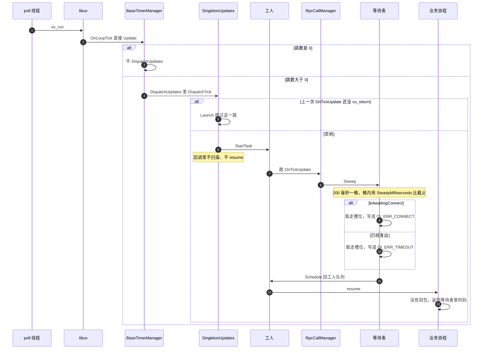

# 调用超时

时间轮在 poll 线程的 `uv_run` 里直接 `Update`。跳数大于 0 才 `DispatchUpdates`。`DispatchTick` 对每个 `OnTickUpdate` 走 `Launch`：上一次还没 `co_return` 就跳过这一跳。否则 `StartTask`。回调里不扫描、不 `resume`。

任务体是 `RpcCallManager::OnTickUpdate`，里面调 `Sweep`。桶按 200 毫秒刻度，桶内用 `SteadyMilliseconds` 比精确截止。精度取决于时间轮一跳。`offset_ms` 默认 50，配置必须能整除 1000。非正超时在登记前打错误日志并改成 30 秒，生产调用都会进超时桶。

多线程：`StartTask` 进工人队列，`Sweep` 在工人上，`Schedule` 也回工人。还在等第一次连上（`bAwaitingConnect`）写成 `OI_ERR_CONNECT`，否则 `OI_ERR_TIMEOUT`。

整桶还没到的刻度不再往下扫。当前桶里没到期的项不挡住后面的。`OnTickUpdate` 不用传入的墙上时间，`Sweep` 自己读 `SteadyMilliseconds`。单调时钟没有前进时，`Update` 直接返回，同样不会 `DispatchUpdates`。

先到的那一件才 `Schedule`。发送失败按 `SendFrame` 的码唤醒：找不到会话或已关闭是 `OI_ERR_CONNECT`，队列超限是 `OI_ERR_BUSY`。组包异常才是 `Wake(OI_ERR_FAIL)`，在 `await_resume` 重抛。回包在 poll 线程的 `DecodeReply` 解开，不在这次扫描里。后到的发现调用号已经取走，不再动这条协程。

回来 `resume` 的工人不一定是跑 `Sweep` 的那一个。单例更新还没 `Start` 时，`DispatchTick` 直接返回。`StartTask` 抛异常时清掉运行标记，这一跳没有 `Sweep`。
