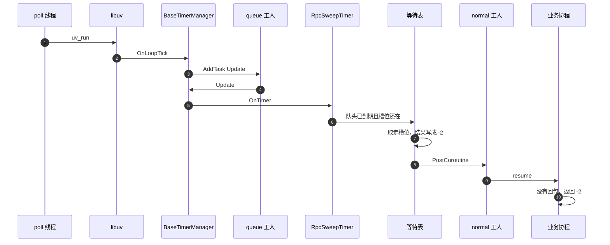

# 调用超时

超时不在 poll 线程上扫。tick 把 `Update` 丢给唯一的 `queue` 工人。扫到之后再 `PostCoroutine` 给 `normal` 工人，由工人 `resume` 并返回 `-2`。

扫描是 200 毫秒一次，按超时秒数分桶，只看每个桶的队头。

发送失败走同一条唤醒，结果是 `-1`。先到的那个算数，后到的 `TakeRpcSlot` 失败就不再动这条协程。
