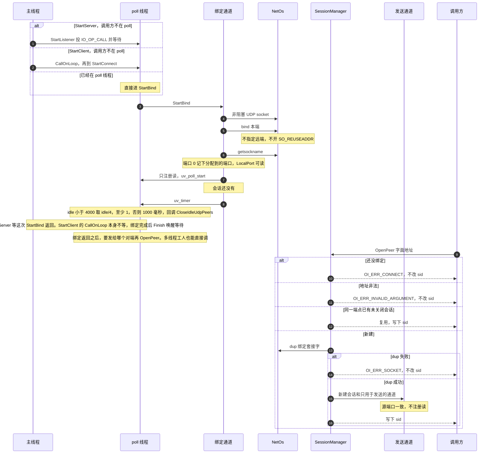
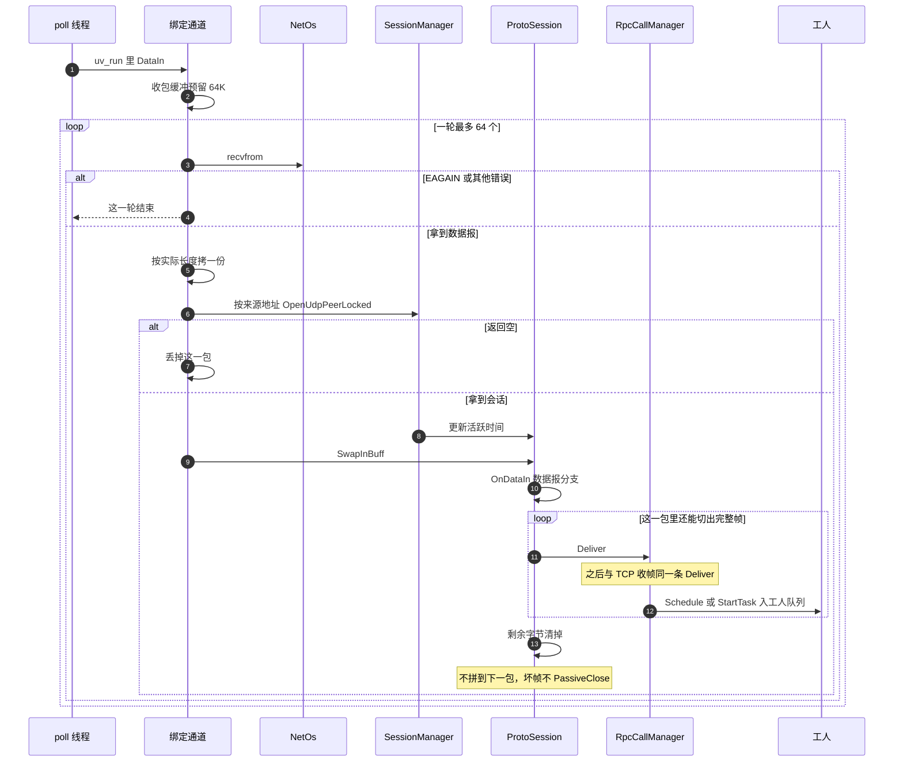
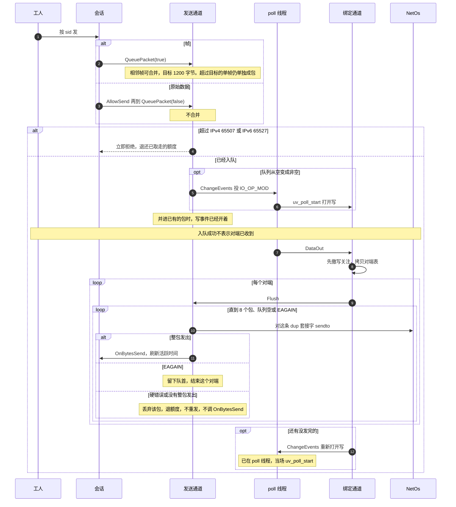

# UDP

`recvfrom` 和 `sendto` 都在 poll 线程。多线程的 `CheckThreadAccess` 不拦调用线程，`OpenPeer` 可以在工人上直接跑，不会投回 poll，也不会返回 `OI_ERR_WRONG_THREAD`。工人上的发送若要改事件，`ChangeEvents` 在这一监视还没有挂起改动时投一条 `IO_OP_MOD`，poll 线程取出后才 `uv_poll_start`。

## 绑定并建对端

`StartServer` 经 `StartAccept` 的 UDP 分支，`StartClient` 经 `StartConnect` 的 UDP 分支，都进 `UDP_Channel::StartBind`。已经有绑定通道时，`StartClient` 直接成功，不再绑一次。只绑本端，不指定远端，不开 `SO_REUSEADDR`。端口 0 用 `getsockname` 得到的端口，`LocalPort` 可读。绑定通道只注册读，会话还没有。

调用方不在 poll 线程时，`StartServer` 的 `StartListener` 投 `IO_OP_CALL` 并等到 `StartBind` 返回。`StartClient` 则 `CallOnLoop`，由 poll 线程 `StartBind`，完成再唤醒等待。已经在 poll 线程上就当场绑定。

`OpenPeer` 只认字面地址。多线程不要求调用方在 poll 线程。还没绑定返回 `OI_ERR_CONNECT`，地址非法返回 `OI_ERR_INVALID_ARGUMENT`。失败不改输出 sid。同一端点已有未关闭会话就复用。否则 dup 绑定套接字，新建会话和一条只用于发送的 `UDP_Channel`，源端口一致。dup 失败返回空，`OpenPeer` 返回 `OI_ERR_SOCKET`。

空闲定时器挂在绑定上，回调在 poll 线程。`idle_timeout_ms` 小于 4000 时，周期取它的四分之一，至少 1 毫秒，否则 1000 毫秒。回调是 `CloseIdleUdpPeers`。

`CloseIdleUdpPeers` 用 `SteadyMilliseconds` 比 `idle_timeout_ms`，默认 60000。先退出对端表的锁，再拿会话锁复查。复查不过就留下。仍到期且未关闭，标 `bPeerIdleExpired`，再 `PassiveClose(ETIMEDOUT)`。`Close` 里 `AllowSend` 看见会话已不是连接中，清掉待发包并退额度，然后 `PostOnLoop`。下一轮 poll 才 `RecycleUdpPeer`：只摘自己那一项，再删掉发送通道。新会话已经顶掉同一端点时，不删新项。已经标过期再入队，直接 `OI_ERR_CONNECT` 并退额度。

## 收一个数据报

只有绑定通道的 `DataIn` 调 `recvfrom`，就在 poll 线程。一轮最多 64 个数据报。收包缓冲按 64K 预留，按实际长度拷一份交给会话。`EINTR` 继续收。空包、地址非法，或 `OpenUdpPeerLocked` 返回空，丢掉这一包，绑定通道还在。

按来源地址 `OpenUdpPeerLocked`。已有未关闭会话就复用，否则 dup 再建。拿到会话就更新活跃时间并 `SwapInBuff`。这一包大于剩余接收额度时，`SwapInBuff` 清掉它并 `PassiveClose(ENOBUFS)`。这和后面切帧失败不关会话不是同一条。

之后走 `ProtoSession::OnDataIn` 的数据报分支。这一数据报里能切出的完整帧交给 `Deliver`。剩余字节清掉，不拼到下一包。坏帧不 `PassiveClose`。多线程入工人队列。之后与 TCP 收帧同一条 `Deliver`。工人不 `recvfrom`。

## 发一个数据报

业务在工人上按 sid 发。帧走 `QueuePacket(true)`：相邻帧可合并，目标 1200 字节；超过目标的单帧仍单独成包。队尾若是原始数据，下一帧也不并上去。原始数据走 `AllowSend`，再到 `QueuePacket(false)`，不合并。

IPv4 超过 65507、IPv6 超过 65527，立即拒绝。字节已经从发送缓冲取走的，`SendBuffered` 退还额度。队列从空变成非空时，给绑定通道打开写事件。工人不是 poll 线程，`ChangeEvents` 投 `IO_OP_MOD`。

`DataOut` 在 poll 线程的绑定通道上。先撤写关注，拷贝对端表，再逐个 `Flush`。`Flush` 对该对端的 dup 套接字 `sendto`，一轮最多 8 个包。`EAGAIN` 留下队首，这一轮扫完后重新打开写事件。整包发出才 `OnBytesSend`，并刷新活跃时间。硬错误或没有整包发出：丢弃该包，退额度，不重发，不调 `OnBytesSend`。入队成功不表示对端已收到。工人不 `sendto`。

