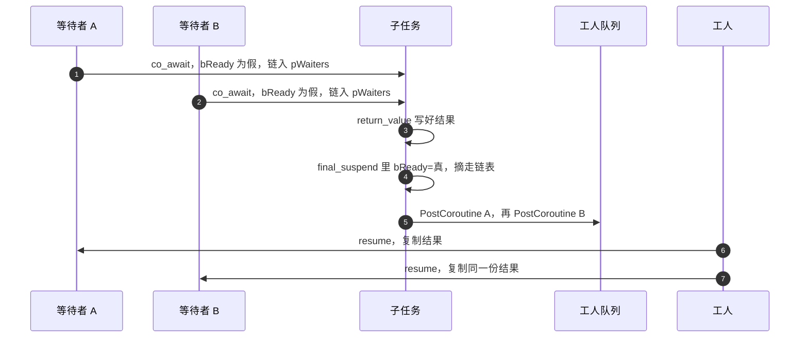
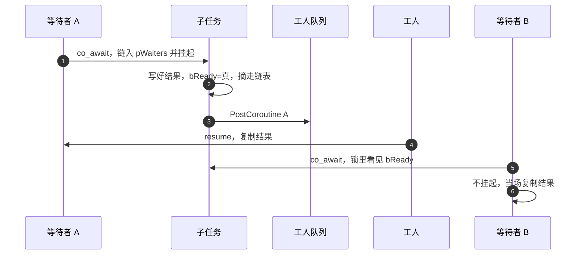
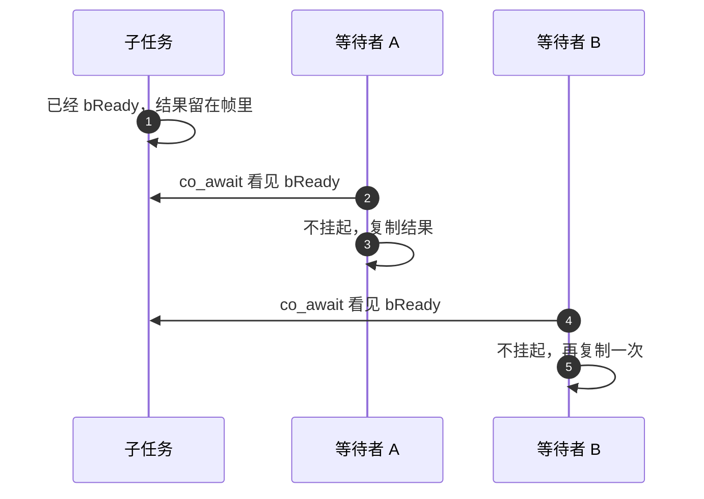

# 同一个任务的多个等待者

两个协程 `co_await` 同一个 `Task` / `TaskResult`。任务只跑一次。`return_value` 先把结果放进 `stResult`，`final_suspend` 才在 `stMutex` 里把 `bReady` 写成真，并摘走 `pWaiters`。`await_resume` 复制结果，不移走。异常留在任务上，每个等待者各抛一次。

`Schedule` 把句柄放进工人队列，不在 poll 回调里 `resume`。单次的 RPC、Redis、HTTP 不走这张表，它们用 [完成门](gate.md)。

## 两个都在完成前

两次 `await_suspend` 都在锁里看见 `bReady` 为假，把自己插到链表头，然后挂起。任务在某个工人上结束，锁里摘空链表，锁外按摘下的顺序 `PostCoroutine`。两个工人之后各 `resume` 一次，进 `await_resume`。

## 一个在完成前，一个在完成后

先来的挂在链表上，由 `final_suspend` 投进工人队列。后来的在锁里看见 `bReady`，不挂起、不再入队，就在当前工人上 `await_resume`。

## 两个都在完成后

两次都不挂起，任务不重新入队。各复制一次已保存的结果，或各抛一次已保存的异常。

