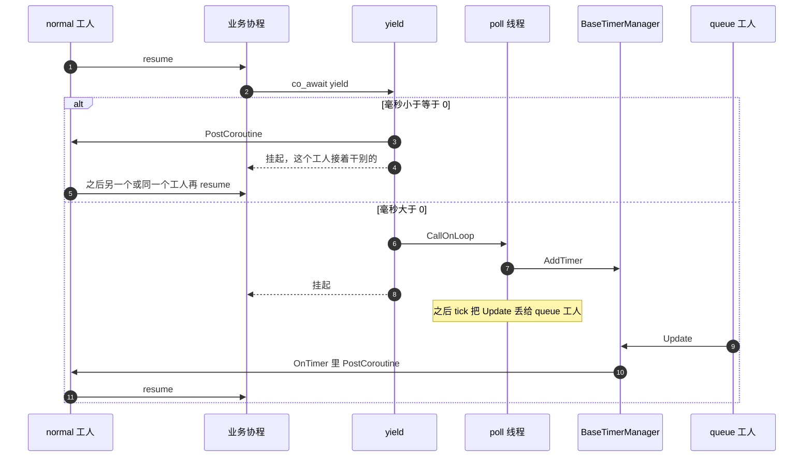

# 让出

空等用 `co_await yield(毫秒)`。业务协程在工人上，时间轮只能在 poll 线程上改。`毫秒 > 0` 时 `CallOnLoop` 到 poll 线程再 `AddTimer`。到点由 `queue` 工人执行 `OnTimer`，再把句柄放回 `normal` 工人，不在定时器回调里 `resume`。

`毫秒 <= 0` 不进时间轮，直接 `PostCoroutine`。

