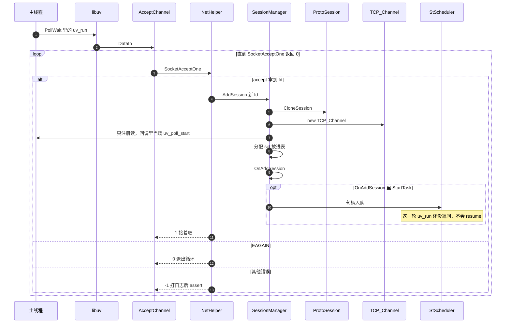

# 接入一条连接

可读发生在主线程的 `PollWait` 里。新连接的读事件也在这次回调里当场挂上。`OnAddSession` 若拉起协程，句柄只进队列，要等这次 `uv_run` 返回之后的下一轮才会 `resume`。

`EINTR` 在 `SocketAcceptOne` 里面重试，不回到这层循环。

对端关掉或读出错时，先把已经读到的字节交给 `OnDataIn`，再 `PassiveClose`。
