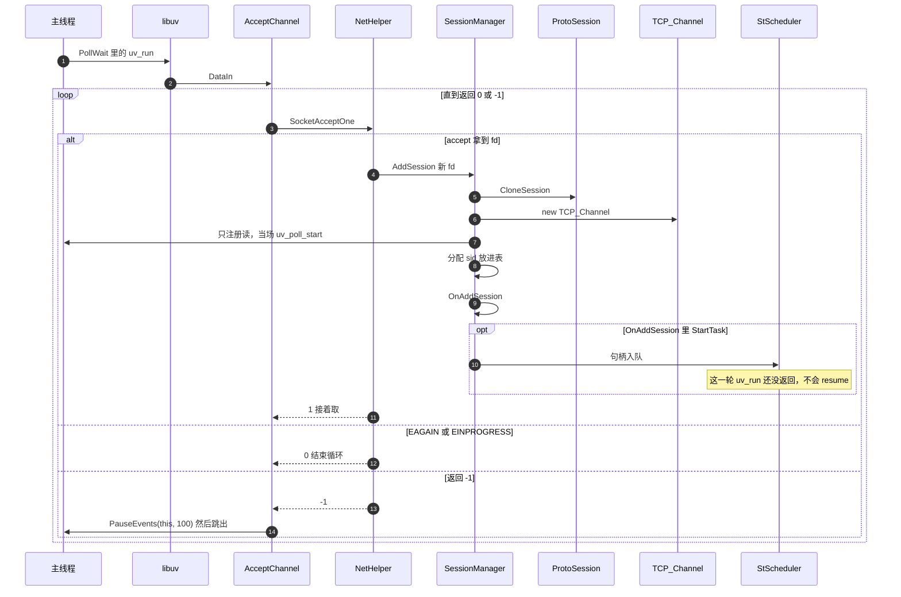

# 接入一条连接

可读或可写发生在主线程的 `PollWait` 里。可写的 `DataOut` 直接转 `DataIn`。新连接只注册读，也在这次回调里当场 `uv_poll_start`。`OnAddSession` 里的 `StartTask` 只入队，这一轮 `uv_run` 还没返回，不会 resume。

`EAGAIN` 和 `EINPROGRESS` 让 `SocketAcceptOne` 返回 0，外层循环结束。`EINTR`、`ECONNABORTED`、`EPROTO` 在 `SocketAcceptOne` 内部继续，不回到外层。返回 -1 时 `PauseEvents(this, 100)`，停 100 毫秒再恢复，避免描述符用尽时空转。意料外的 errno 会先打日志；还没 listen 这类检查失败也是 -1，不打这行日志。

注册新连接失败时关掉这个 fd 并释放会话，`SocketAcceptOne` 仍返回 1，外层继续收。

