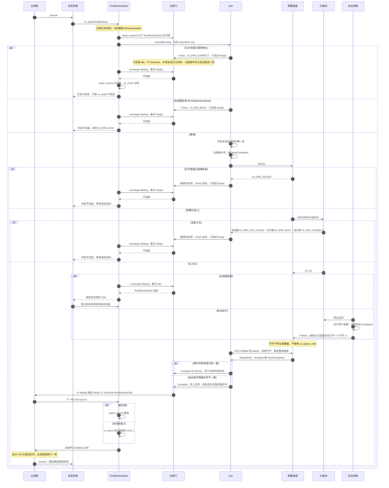

# 阻塞任务

业务在主线程上 `co_await RunBlocking`。前端不是协程：右值进闭包，再进入 `RunBlockingTask`。协程里调用时，`RunBlockingTask` 当场跑到 `BlockingAwaiter`。`await_suspend` 先记下这条任务的句柄，再 `SubmitBlocking`。

图里的 poll 就是主线程上的循环。`CallOnLoop` 发现已经在 poll 线程，当场 `SubmitOnLoop`。后台是该 `BlockingType` 的固定线程，用户函数在那里执行。完成靠本地 socketpair 回到 poll，`DataIn` 在挂起之后的 `PollWait` 里跑。

已关闭，或线程池已请求停止，`Finish` 带回 `OI_ERR_CONNECT`。本地会话已经关闭，也是 `OI_ERR_CONNECT`，发生在分配操作号之前。该类型在途数达到 `BlockingPoolCapacity`，带回 `OI_ERR_BUSY`。在途含排队、执行中和完成通知还没消费的工作；Default 的上限是线程数加队列上限，再与 1024 取较小值。这两种都在完成回调里把门写成 `Ready`。`exchange(Waiting)` 看见 `Ready`，`RunBlockingTask` 不挂起，当场 `co_return`。外层任务已经完成，业务的 `co_await` 看见 `bReady`，也不挂起。

未配置的非 `Default` 不在池表里，`BlockingPoolCapacity` 为 0，入场不按在途拒绝。`SubmitBlockingWork` 返回 `OI_ERR_NOT_FOUND`。池队列已满返回 `OI_ERR_BUSY`，池已停止返回 `OI_ERR_CONNECT`。第一次 `OpenPair` 或登记读端失败返回 `OI_ERR_SOCKET`。这些都撤销刚登记的待定项，再 `Finish` 该码，同样不挂起。提交过程抛出的异常用 `Finish(OI_OK, 异常)` 交回，`await_resume` 重抛。

接纳后在 poll 上分配操作号，跳过 0，也不占用仍在途的号。编一帧 `WorkCompleted`，协议号 `WORK_PROTOCOL_COMPLETED`，包体只有操作号，交给 `BlockingWorkChannel::Submit`。通道第一次打开本地 socketpair，读端挂到 poll。`SubmitBlockingWork` 把工作放进该类型的队列。不使用 `uv_queue_work`。

工作线程执行用户函数，异常收进 completion，然后 `Publish`。结果进本地就绪链表。链表从空变成非空时 `Wakeup` 写一个字节 `w`。字节不带业务数据。poll 读掉这个字节，取走整条链表，`SwapInBuff` 把预先编好的帧交给会话。`OnDataIn` 解 `WorkCompleted`。操作号必须和完成记录一致，然后 `Complete`。对不上或协议损坏也 `Complete`，带上当前异常，操作号用完成记录里的。

`Complete` 取出待定项并调用 `fnDone`。`fnDone` 写下状态码和异常。门从 `Waiting` 换成 `Ready` 才 `Schedule`。唤醒的是 `RunBlockingTask`。它在下一轮 `Poll` 里 `resume`：有异常就在 `await_resume` 重抛，否则状态码为 0 时 `co_return` 用户函数的 `int32_t`。业务由任务结束时再放进队列。这次 `Poll` 已经拿走队列，业务要再等一轮。丢弃 Task 不取消工作。

丢弃 Task 不取消已经进池的工作。提交过程里的 C++ 异常同样在这次 `SubmitOnLoop` 里 `Finish(OI_OK, 异常)`，`exchange(Waiting)` 看见 `Ready`，不挂起，异常在 `await_resume` 重抛。
