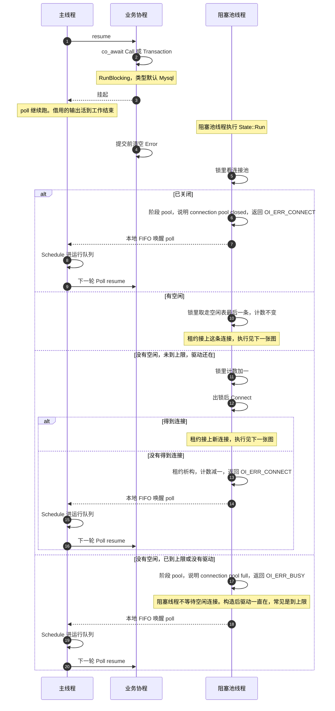

# 数据库调用

`Call` 接收 SQL 和参数，`Transaction` 接收由 `Batch::Add` 组装的语句；单表和标量入口复用这些路径，结果行按列名保存。

`Client::Call` 和 `Client::Transaction` 都是 `co_await OI::Coro::RunBlocking`。阻塞类型是客户端构造时的 `BlockingType`，默认 `Mysql`。`Call` 的 `Result`、`Error`，以及 `Transaction` 的结果数组、`Error`，都是借用，必须活到这次工作真正结束。丢掉返回的 `Task`，工作仍会跑完。

同步驱动跑在该类型的阻塞池线程上。完成后经本地 FIFO 会话唤醒 poll，再 `Schedule` 回业务协程。细节见 [blocking.md](blocking.md)。公开 `Call` 和 `Transaction` 提交前清空 `Error`；若工作在进入 `State::Run` 前被阻塞池拒绝，不会产生驱动错误详情。

单线程里业务协程在主线程上，挂起期间 poll 仍能跑。阻塞池线程是真实线程。唤醒之后 `Schedule` 进运行队列，下一轮 `Poll` 再 `resume`。

借连接在 `State::Run` 里做。已关闭、池满、`Connect` 没有给出连接，这三支直接返回，不执行语句。

拿到连接之后，`Call` 执行这一条语句。`Transaction` 在同一条借用连接上按顺序执行，失败则尝试回滚。失败的写入不会再提交一次。`Call` 的语句失败仍先把连接标成可复用，健康且 `Reset` 成功就放回。事务里某条失败，要回滚返回 `OI_OK` 才标成可复用。`BEGIN` 失败和 `COMMIT` 失败不放回。临时结果留在 `Run` 自己的数组里。只有业务码是 `OI_OK` 时，阻塞线程才把它写进调用方；`resume` 之后调用方再读。

```mermaid
sequenceDiagram
    autonumber
    participant Main as 主线程
    participant Biz as 业务协程
    participant Pool as 阻塞池线程
    participant Db as 借用的连接

    Note over Pool: 已经拿到连接。调用方结果尚未写入
    alt Call
        Pool->>Db: Execute 这一条
        alt 语句失败
            Pool->>Pool: bReusable = true
            Note over Pool: 业务码是这条语句的返回码
        else 语句成功
            Pool->>Pool: 这一行留在临时数组，bReusable = true
            Note over Pool: 业务码是 OI_OK
        end
    else Transaction
        Pool->>Db: Execute BEGIN
        alt BEGIN 失败
            Note over Pool: 事务守卫还没建。bReusable 保持 false。业务码是 BEGIN 的返回码
        else BEGIN 已经成功
            alt 按顺序执行时某条失败
                Pool->>Db: Execute 到失败的那条
                Note over Pool: 失败前成功的行留在临时数组。后面的语句不执行
                Pool->>Db: 尝试 ROLLBACK
                alt 回滚返回 OI_OK
                    Pool->>Pool: bReusable = true
                    Note over Pool: 这一步不改 stCleanup
                else 回滚返回非 0
                    Pool->>Pool: bReusable = false
                    Note over Pool: stCleanup.bFailed，阶段 rollback，诊断来自回滚
                else 回滚抛异常
                    Pool->>Pool: bReusable = false
                    Note over Pool: stCleanup 标 bFailed 和 bException，不写阶段
                end
                Note over Pool: 守卫改为不活动，析构不再回滚。业务码是失败那条的返回码
            else 每条都成功
                Pool->>Db: 按顺序 Execute，成功一条追加一条
                Pool->>Db: Execute COMMIT
                alt COMMIT 失败
                    Pool->>Db: 再尝试 ROLLBACK
                    Note over Pool: 返回值不写入 bReusable，bReusable 保持 false
                    alt 回滚返回非 0
                        Note over Pool: 记入 stCleanup，阶段 rollback
                    else 回滚抛异常
                        Note over Pool: stCleanup 标 bFailed 和 bException
                    else 回滚成功
                        Note over Pool: 不改 stCleanup
                    end
                    Note over Pool: 不调用 Reset。守卫改为不活动。业务码是 COMMIT 的返回码
                else COMMIT 成功
                    Pool->>Pool: 守卫改为不活动，bReusable = true
                    Note over Pool: 业务码是 OI_OK。BEGIN 和 COMMIT 的结果不进临时数组
                end
            end
        end
    end
    alt bReusable 仍为 true
        Pool->>Db: Healthy
        alt 不健康
            Pool->>Pool: bReusable = false
            Note over Pool: 不改 stCleanup
        else 健康
            Note over Pool: 调用 Reset 前先把 stCleanup.bFailed 标上
            Pool->>Db: Reset
            alt Reset 返回 true
                Pool->>Pool: bFailed 清掉，保持可复用
            else Reset 返回 false
                Pool->>Pool: bReusable = false
                Note over Pool: stCleanup 抄 Reset 的阶段、原生码、SQLSTATE、说明
            end
        end
        Note over Pool: Healthy 或 Reset 抛异常时，bReusable = false，并标上 bFailed 和 bException
    else 不可复用
        Note over Pool: bReusable 为 false 时清理直接跳过。BEGIN 失败和 COMMIT 失败连 Reset 都不调用
    end
    Note over Pool: 清理失败留在 stCleanup，不改已经得到的业务码
    Pool->>Pool: 租约析构，持池锁
    alt 可复用、连接还在、池未关
        Pool->>Pool: 放回空闲表，计数不变
    else 不可复用、池已关，或放回抛异常
        Pool->>Pool: 计数减一，连接销毁
        Note over Pool: 放回抛异常时 catch 为空，接着减计数
    end
    alt 业务码是 OI_OK
        Pool->>Pool: 阻塞线程把临时结果写入调用方
        Note over Pool: Call 写这一条，Transaction 移入整组。Reset 失败也保持 OI_OK
    else 失败
        Pool->>Pool: 不写调用方结果
        Note over Pool: Result 或结果数组保持调用前的内容。已成功的行不交出去
    end
    Pool-->>Main: 本地 FIFO 唤醒 poll
    Main->>Main: Schedule 进运行队列
    Main->>Biz: 下一轮 Poll resume，得到 int32_t
```

给出的语句数组为空时，`BEGIN` 成功后没有语句循环，直接 `COMMIT`。两边都成功则业务码是 `OI_OK`，调用方数组被换成空。

`Connect` 或语句 `Execute` 抛出的异常，先走已经构造的析构，再离开 `Run`。事务守卫若还标着活动，会再尝试一次 `ROLLBACK`，错误不写入 `stCleanup`。租约的 `bReusable` 仍是 false，析构减计数；手里若还有连接就销毁。异常不改写成业务返回码，由阻塞工作带回这次 `await`。`COMMIT` 返回非 0 走图里的那一支：用会写 `stCleanup` 的回滚，并把守卫改成不再回滚第二次。

`Close` 先在主线程的业务协程里 `StopAccepting`，锁里把 `bClosed` 置上。随后 `co_await RunBlocking` 同一类型，在阻塞池线程里 `CloseIdle`：锁里换出全部空闲连接，计数减去换出的条数，出锁后销毁，返回 `OI_OK`。正在执行或正在 `Connect` 的连接不在空闲表里；租约结束时看见已关闭，不再放回，计数减一并销毁。之后新的 `Run` 走第一张图的已关闭分支。`RunBlocking` 若在进入 `CloseIdle` 之前被拒绝，拒绝码直接返回，空闲连接还在，客户端已经是关闭状态，再 `co_await Close` 才会再关空闲连接。

没有 `Close` 就析构，并且空闲表里还有连接时，先换到一块共享缓冲，再 `SubmitBlockingWork` 到同一类型的阻塞池里销毁。闭包留着驱动，连接先于驱动析构。返回码不是 `OI_OK` 时，在析构所在的线程同步销毁。分配或提交抛异常时，已经换出的随这块缓冲在析构线程销毁，还没换出的随空闲表成员销毁。空闲表为空则析构什么都不做。这条路不改连接计数。
