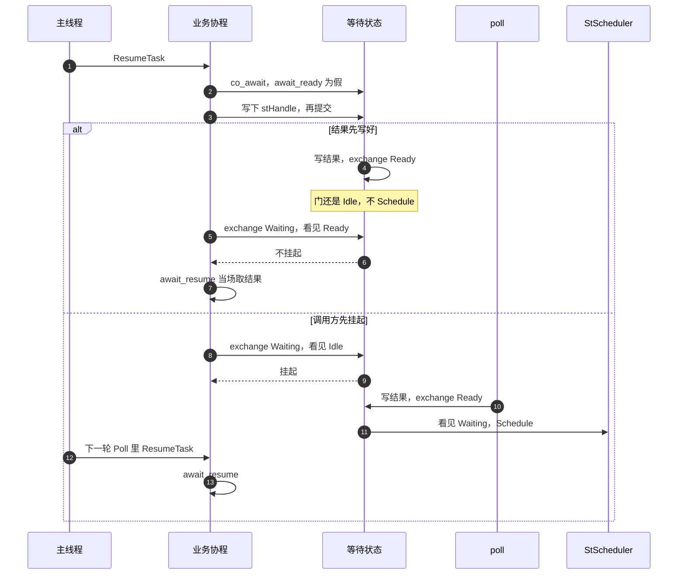

# 完成门

单次等待用 `coro::Gate`。RPC、注册表路由、Redis 协程调用和 HTTP 都是这一道门。`Task` 可以有多个等待者，走完成列表，不走这里。

状态上先记下 `stHandle`。结果字段在 `exchange(Ready)` 之前写完：RPC 是 `iResult` / `bReplied`，路由是 `iCode` / `vList`，Redis 是 `pReply` / `iStatus`，HTTP 是 `iStatus` / `sBody` / `bFailed`。门还是 `Idle` 时不 `Schedule`。第二次完成由各自的一次性标记挡住，RPC 摘走调用号，Redis 用 `iWon`，HTTP 用 `iDone`，不再改已经写好的结果。

