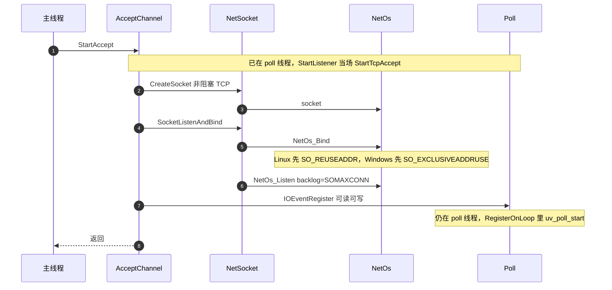

# 服务端开始听

`StartServer` 在主循环之前。主线程已经是 poll 线程，`StartListener` 当场执行，不进操作队列。这里只 bind 和 listen，还没有连接。

`NetOs_Bind` 在 Linux 上先 `SO_REUSEADDR` 再 bind，Windows 上先 `SO_EXCLUSIVEADDRUSE` 再 bind。`listen` 的 backlog 是 `SOMAXCONN`。`type=udp` 不走这条，回调里转到 `UDP_Channel::StartBind`。

单线程不在 poll 线程时，`CheckThreadAccess` 和 `StartListener` 都返回 `OI_ERR_WRONG_THREAD`，不会投递。TCP 听上之后还要 `Publish`，失败就 `StopAccept`。UDP 不登记。

