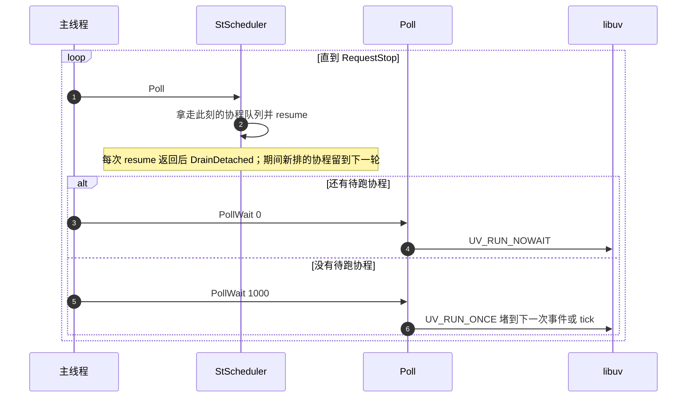

# 主循环

主线程每一轮先 `StScheduler::Poll`。它拿走此刻的整条协程队列并 `resume`。`resume` 期间新排的协程进的是新队列，留到下一轮。

还有待跑协程就 `PollWait(0)`，一次都不堵。没有才 `PollWait(1000)`。这里的 `1000` 只表示要堵住，`uv_run` 收到的是 `UV_RUN_ONCE`，不是 1000 毫秒。时间轮的 tick 每 `offset_ms`（默认 50 毫秒）会把它唤醒一次。

时间轮到点是在 `uv_run` 里直接执行 `Update`，回调只 `Schedule`，被唤醒的协程在下一轮 `Poll` 里 `resume`。
