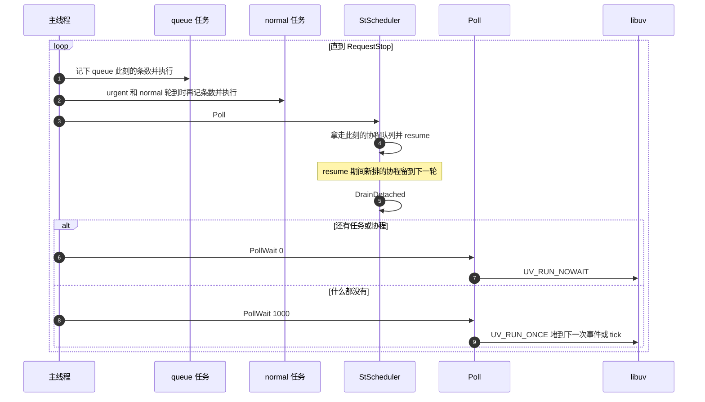

# 主循环

主线程每一轮按 `queue`、`urgent`、`normal` 的顺序跑任务。每个优先级轮到它时才记下当时的条数，只跑这么多。所以高优先级任务投给低优先级的任务这一轮就跑，同一优先级执行中再投的才留到下一轮。

任务跑完再 `StScheduler::Poll`。它拿走此刻的整条协程队列，任务里 `Schedule` 的协程也在这一轮 `resume`。`resume` 期间新排的协程进的是新队列，留到下一轮。

还有活就 `PollWait(0)`，一次都不堵。什么都没有才 `PollWait(1000)`。这里的 `1000` 只表示要堵住，`uv_run` 收到的是 `UV_RUN_ONCE`，不是 1000 毫秒。时间轮的 tick 每 `offset_ms`（默认 50 毫秒）会把它唤醒一次。

时间轮到点是在 `uv_run` 里把 `Update` 放进 `queue` 任务。轮子要等下一轮开头才转。
