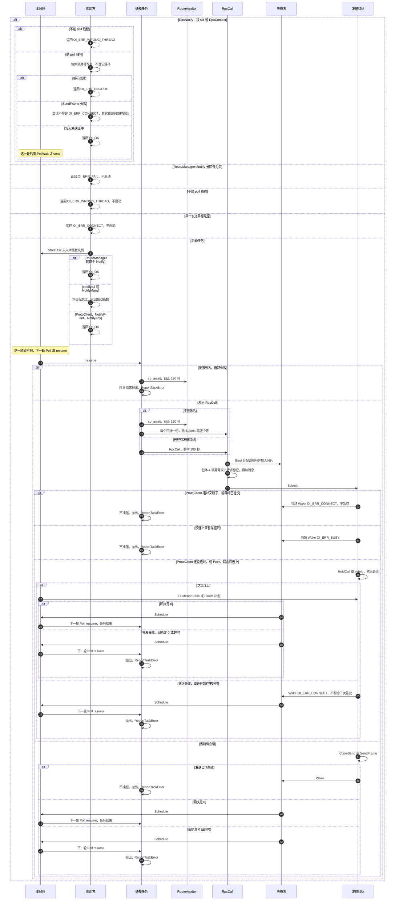
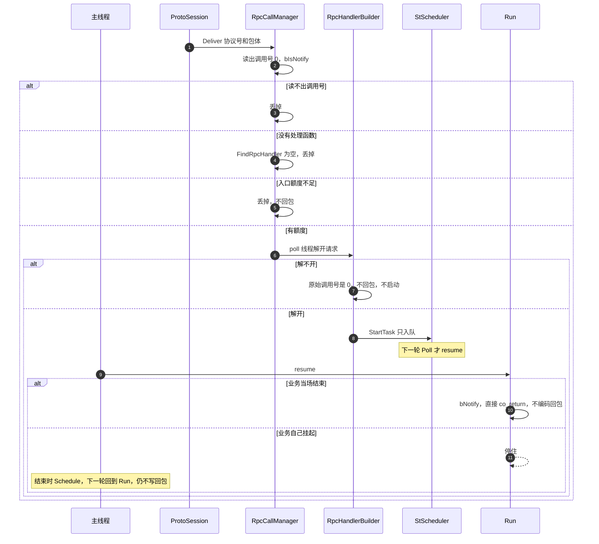

# 单向消息

## 发出

按 sid 的 `Notify` 和 `RpcContext::Notify` 走 `RpcNotify`。不是 poll 线程就返回 `OI_ERR_WRONG_THREAD`。包体调用号写 0，不登记等待，当场 `SendFrame`。返回值是编码或发送的错误码。

`ProtoClientManager::Notify`、多连接的四个 `Notify`，以及 `RouteManager` 的四个 `Notify`，走 `StartTask`。返回值只表示任务已经启动。消息按值拷进闭包。任务里再 `RpcCall`：`Bind` 分配调用号，包体是调用号或上请求标记，登记等待，默认 180 秒。发送、回执或超时失败在任务里抛出，独立任务交给 `ReportTaskError`，不改调用方已经返回的值。

`StartTask` 只入本线程队列。这一轮 `Poll` 已经把队列拿走，下一轮才跑。任务就在主线程上。帧进发送缓冲之后同 [发出一次调用](send.md)。

`ProtoClientManager::SubmitCall` 只在还没连过时 `HoldCall`。已经连过再断线，`Wake` 成 `OI_ERR_CONNECT`，不暂存。`PeerConnection::Submit` 不看连过没有：当前没有会话就放进 `vHeld`，`Ensure` 去连，这次连上由 `Finish` 补发。路由的发送目标也是 `PeerConnection`。

分区号为负在检查线程之前返回。`NotifyAll` / `NotifyMany` 可以启动 0 条。服务或分区不存在留在路由任务里，`RouteCall::Error` 的 default 是 `OI_ERR_CONNECT`。还在暂存里到期写成 `OI_ERR_CONNECT`，发出之后到期写成 `OI_ERR_TIMEOUT`，见 [调用超时](timeout.md)。这次建连失败会把 `vHeld` 唤醒成 `OI_ERR_CONNECT`，不留给下一次重试。UDP 上 `sendto` 失败发生在入队之后。`RpcNotify` 当时已经按入队结果返回，通常是 `OI_OK`。这一包被丢掉，已经登记的调用不会因此结束。

## 收到

切帧同 [收到一帧](receive.md)。这里只看调用号 0。

`Deliver` 在主线程读出调用号。0 是 `bIsNotify`，按请求找 `FindRpcHandler`。没有处理函数就丢。`AcquireAdmission` 拿不到租约也丢，不回 `OI_ERR_BUSY`。解开在 poll 线程。解开才 `StartTask`，只入本线程队列，下一轮 `Poll` 才跑。`Run` 看见原始调用号 0，业务结束后直接 `co_return`，不编码回包。解不开不回包，不启动协程。

业务返回码不写回包。处理函数抛出只报告，也不回包。
