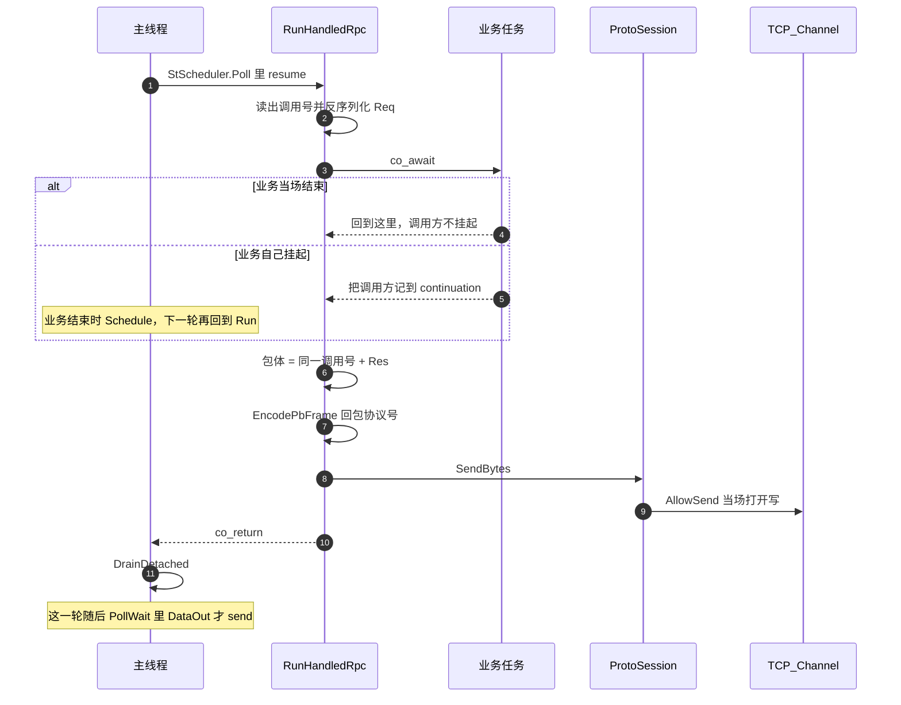

# 处理并回包

处理协程在主线程的下一轮 `StScheduler::Poll` 里跑。业务当场结束时，调用方不挂起。回包在这次 `resume` 里写进发送缓冲，并当场打开写事件。字节要等这一轮后面的 `PollWait` 才 `send`。

`co_return` 不在 `final_suspend` 里销毁帧。`resume` 返回后 `DrainDetached` 再销毁。

`ipcserver` 的 `AllEcho` 当场把请求抄进回包。`Hold` 在 `delay_ms > 0` 时先 `yield`，到点再回。
