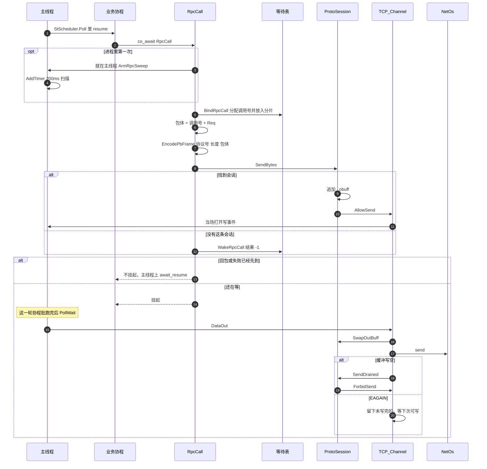

# 发出一次调用

业务协程在主线程的 `StScheduler::Poll` 里跑。挂起前就把帧写进发送缓冲。因为这里就是 poll 线程，打开写事件是当场 `uv_poll_start`。真正 `send` 在这一轮后面的 `PollWait`。

回包、发送失败、超时，这三件事里只有先到的那一件会把协程放回队列。

解包在主线程的 `await_resume`。解出来返回 `0`，解包失败返回 `-1`。没收到回包就返回等待表里已经写下的结果。
