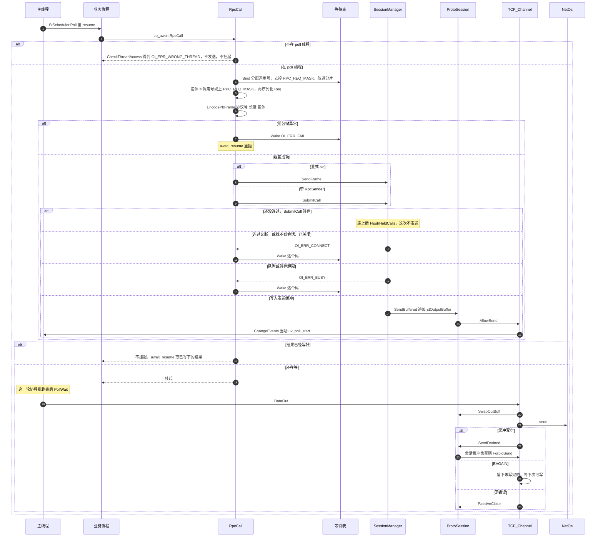

# 发出一次调用

这是一条 `RpcCall`。按服务名选实例见 [按服务名调用](route.md)。选路之后这里只用 `RpcDeadline` 剩下的毫秒。`CallAll` 和 `CallMany` 对每一台先 `Submit`，把帧写进发送缓冲，再逐个 `co_await` 已经在途的等待器。

业务协程在主线程的 `StScheduler::Poll` 里跑。挂起前 `Dispatch`。不在 poll 线程，`CheckThreadAccess` 直接 `OI_ERR_WRONG_THREAD`，不分配、不发送。在 poll 线程上，`Bind` 分出的调用号去掉 `RPC_REQ_MASK`，写进包体时再或上。显式 sid 直接 `SendFrame`。按服务名或客户端对象发出时带 `RpcSender`，走 `SubmitCall`：已经连上再 `SendFrame`；还没连过就暂存，连上后 `FlushHeldCalls`；已经连过再断线是 `OI_ERR_CONNECT`；暂存超限是 `OI_ERR_BUSY`。这里就是 poll 线程，`ChangeEvents` 当场 `uv_poll_start`。真正 `send` 在这一轮后面的 `PollWait`。

回包、发送失败、超时，这三件事里只有先到的那一件会 `Schedule`。还没连上就到期是 `OI_ERR_CONNECT`，已经发出后到期是 `OI_ERR_TIMEOUT`。

回包在 poll 线程的 `DecodeReply` 里解开，由 `FinishSlot` 调用，不在 `await_resume`。状态码为 0 时，`await_resume` 把已解出的对象移进调用方输出。解不开时码是 `OI_ERR_FAIL`，对象不移，异常只报告，不重抛。没收到回包就返回等待表里已经写下的码。

组包抛异常才 `Wake(OI_ERR_FAIL)` 并在 `await_resume` 重抛。槽已经被取走时，这次 `Wake` 不再改结果，异常仍重抛。`EINTR` 再写一次。写空之后会话缓冲又有数据，就不 `ForbidSend`。硬错误 `PassiveClose` 之后关掉会话，还在表里的调用按 `OI_ERR_CONNECT` 结束。带对端地址的 UDP 不走这条 `DataOut`。

这次 `Dispatch` 还在 `Poll` 里，网络回包要等后面的 `PollWait`。先写好结果、因而不挂起的，是发送失败或组包异常。
