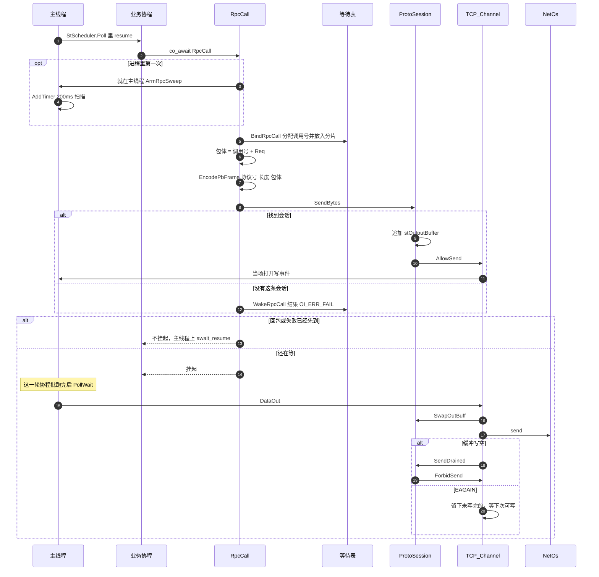

# 发出一次调用

这是一条 `RpcCall`。按服务名选实例见 [按服务名调用](route.md)。选路之后这里只用 `RpcDeadline` 剩下的毫秒。`CallAll` 和 `CallMany` 对每一台先 `Submit`，把帧写进发送缓冲，再逐个 `co_await` 已经在途的等待器。

业务协程在主线程的 `StScheduler::Poll` 里跑。挂起前就把帧写进发送缓冲。因为这里就是 poll 线程，打开写事件是当场 `uv_poll_start`。真正 `send` 在这一轮后面的 `PollWait`。

回包、发送失败、超时，这三件事里只有先到的那一件会把协程放回队列。

解包在主线程的 `await_resume`。解出来返回 `OI_OK`，解包失败返回 `OI_ERR_FAIL`。没收到回包就返回等待表里已经写下的结果。
