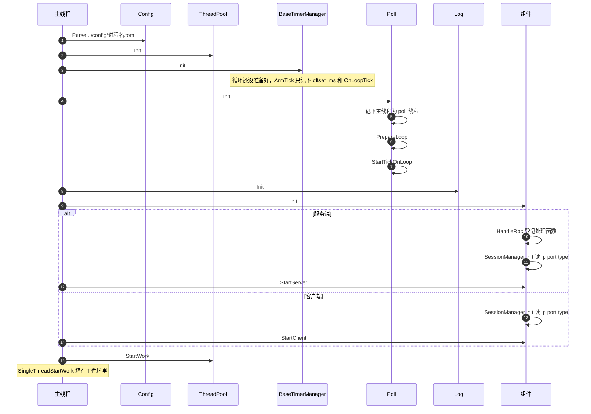

# 进程起来

单线程没有第二条线程。`Poll::Init` 在主线程上准备循环并挂上 tick。`StartWork` 进入主循环之后不再返回。

`ipcclient` 在 `StartClient` 之前，若开了 Redis 或 Hold，会先把 `RedisClient` 连上。HTTP 探测在 `ipcserver` 听上之后用 `StartTask` 拉起，不等它。句柄进单线程队列，要等主循环开始才会跑。
