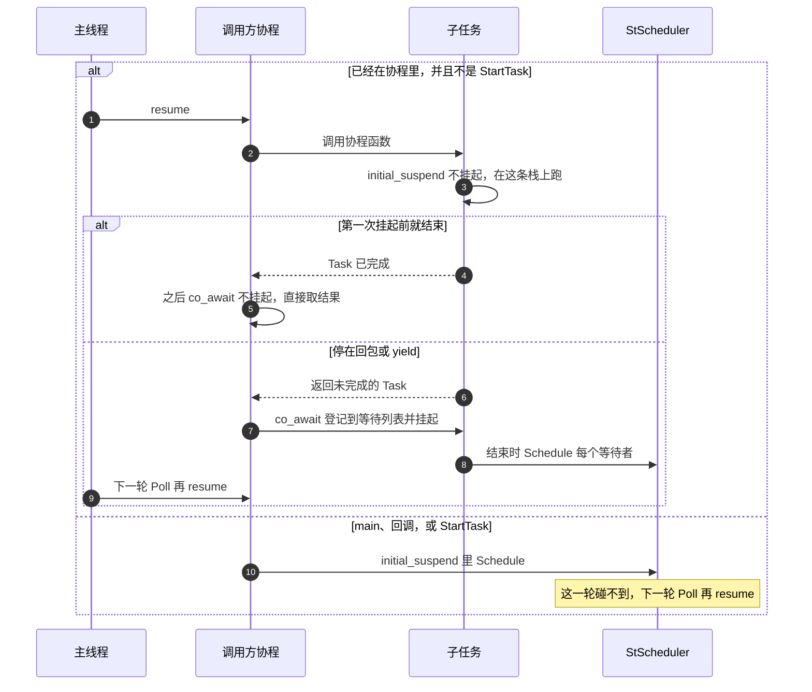

# 任务创建即运行

在协程里直接调用协程函数，子任务的 `initial_suspend` 不挂起，当场在调用方栈上跑到第一次 `co_await`。当场跑完的，外层之后的 `co_await` 不再挂起，直接取已保存的结果。

协程外（`main`、网络回调、定时器回调）新建的任务，以及 `StartTask`、`TaskScope::Start`，`initial_suspend` 把句柄放进单线程队列。这一轮 `Poll` 已经把队列拿走，新句柄要等下一轮。

同一个 `Task` / `TaskResult` 可以给多个协程等，任务只跑一次。完成后的等待者直接拿保存的结果或异常，不再入队。

