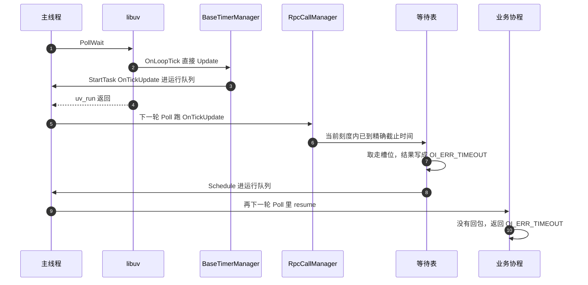

# 调用超时

时间轮在 `uv_run` 里直接 `Update`，只把 `RpcCallManager::OnTickUpdate` `StartTask` 进本线程运行队列，不在 libuv 回调里扫描或 `resume`。这一轮 `Poll` 已经把队列取走，扫描留到下一轮 `Poll`；扫到的到期项再 `Schedule`，再下一轮才 `resume`。

分桶仍按 200 毫秒刻度，桶内逐项按精确截止时间判断，计时用 `OI::Timer::SteadyMilliseconds`。超时精度取决于时间轮一跳（`offset_ms`，正常 10–50 毫秒）。已经发出之后到期写成 `OI_ERR_TIMEOUT`。还在等第一次连上就到期，写成 `OI_ERR_CONNECT`。

发送失败或解包失败走同一条唤醒，结果是 `OI_ERR_FAIL`。先到的那个算数，后到的发现调用号已经取走，就不再动这条协程。
