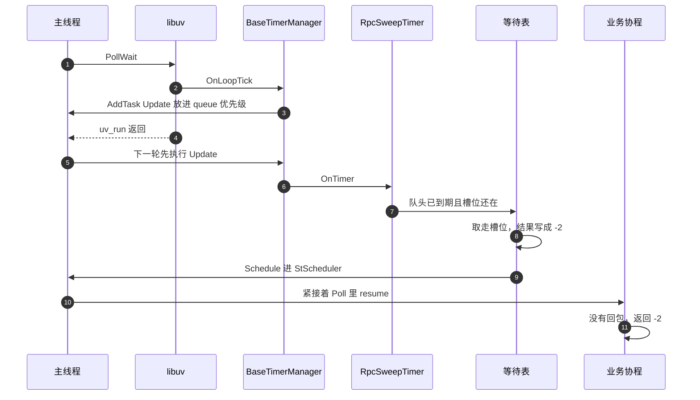

# 调用超时

超时不在 libuv 回调里扫。tick 只把 `Update` 放进任务队列。单线程先跑 `queue` 优先级的任务，再 `Poll` 协程，所以同一次循环里就能 `resume`。

扫描是 200 毫秒一次，按超时秒数分桶，只看每个桶的队头。结果写成 `-2`。

发送失败走同一条唤醒，结果是 `-1`。先到的那个算数，后到的 `TakeRpcSlot` 失败就不再动这条协程。
