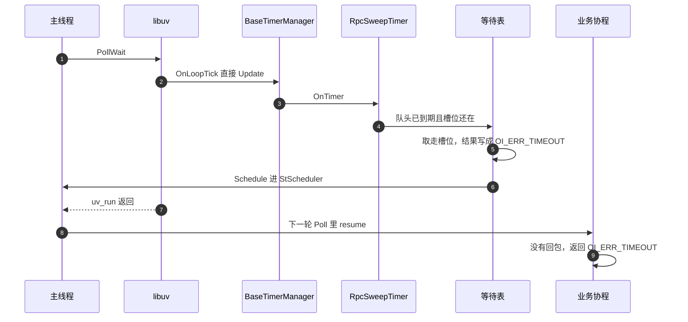

# 调用超时

tick 在 `uv_run` 里直接执行 `Update`，扫到到期项只 `Schedule`，不在 libuv 回调里 `resume`。`PollWait` 返回后，下一轮 `Poll` 再 `resume`。

扫描是 200 毫秒一次，按超时毫秒数分桶，只看每个桶的队头。已经发出之后到期写成 `OI_ERR_TIMEOUT`。还在等第一次连上就到期，写成 `OI_ERR_CONNECT`。

发送失败或解包失败走同一条唤醒，结果是 `OI_ERR_FAIL`。先到的那个算数，后到的 `TakeRpcSlot` 失败就不再动这条协程。
